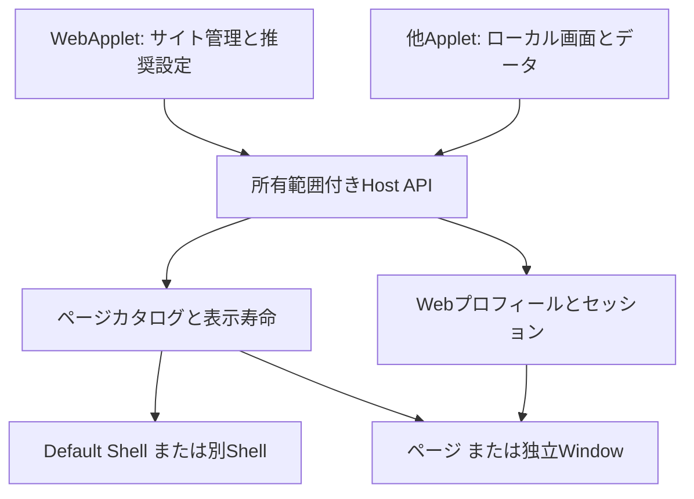

# 動的ページAPIとWebApplet分離

## 目的と構成

AppDock 0.44.0で、1つのAppletから複数ページを動的に提供する基盤を追加する。最初の利用者として、従来の本体組み込みWebAppletを独立した`Applet.WebApplet.at365` 0.1.0へ移す。独立AppletはTypeScript/NodeとローカルHTMLで構成し、.NET・Electronの直接利用・別途Nodeのインストールを必要としない。

配布・更新・プロセスの単位は親Applet、表示・選択・ウィンドウ位置の単位はページとする。Web以外の文書、メモ、ダッシュボード等も同じ仕組みで実装できる。ローカルHTML/Reactの描画にはホストのChromiumを使用する。WPF/WinForms/HWNDの埋め込みは含まない。

本書は採用した設計と0.44.0の契約を記載する。実測・未確認範囲は[VERIFICATION](../VERIFICATION.md)に分離する。



## 責務

| 所有者 | 責務 |
| --- | --- |
| Applet.WebApplet.at365 | サイト一覧、初期ショートカット、追加/編集画面、推奨JSONの取得と解釈、手動値との調整 |
| AppDock | ページの所有者検査・表示・破棄、プロフィール名簿とCookie、設定revision/原子的保存、画像検証、キー入力 |
| Shell | 共通モデルからリボン、一覧、設定、ホームを描画 |
| 保存済みの識別情報 | 既に記録された旧ID・名簿・session保存先の参照。設定の変換や取り込みは行わない |

本体の通常処理は`at365.web-applet`や`web.`接頭辞で提供機能を判断しない。提供元manifestの宣言を使う。旧IDを取得できるのは移行マーカーに記録されたサイトだけとする。

## 3つの登録方法

1. **固定ページ**: 既存のmanifest.pagesを維持する。最大10件。
2. **実行中のページ**: `context.pages.replace`でローカル画面を一括登録する。最大64件。停止・異常終了で失効し、次の起動でAppletが再登録する。
3. **設定由来のページ**: manifest.pageCollectionsで自身のobject-list設定を宣言する。最大4コレクション、1親Appletにつき合計64項目。local/remoteの双方に対応し、停止中も設定と管理項目を投影する。

実行中のページは親Appletのリボン項目となる。設定由来の項目はApplet一覧にも独立した管理項目を持ち、個別の有効状態・公開設定・キー割当を持つ。子の実行プロセスや更新物は作らない。保存された子のenabledは親を停止しても保持し、実効状態は親と子の両方で決める。

リモートページを実行中APIから直接登録する形式は0.44.0では提供しない。保存された参照を持つpageCollectionsを使い、プロフィール削除の参照判定を停止中も維持する。

## 実行中ページのAPI

`pages`と`dynamic-pages` capability、minimumHostVersion 0.44.0が必要。Nodeラッパーと`host.pages.*`は同じ処理を使う。

| Node | 引数と結果 |
| --- | --- |
| pages.list() | 自身の固定＋実行中ページ定義、登録revision |
| pages.replace(pages, expectedRevision) | 実行中の定義だけを全置換。新revisionを返す |
| pages.open(id) | 自身の固定/実行中localページを開く |
| pages.hide(id) | 非表示にし、入力とViewを保持する |
| pages.dispose(id) | Viewを破棄する。登録は残り、次のopenで再生成 |
| pages.openItem(id) | 自身の設定由来の管理項目を開く |

実行中の定義は`{id,title,source:'local',ui,icon?,defaultDisplay?,context?}`。uiはAppletフォルダー内の実HTMLを指定し、フォルダー外参照や転送された資産を包含検査で拒否する。contextは16KB以下のJSONオブジェクト。固定IDとの衝突、動的ID重複、上限超過、古いrevision、コマンド衝突を全体として拒否する。

生成される開くコマンドは`<owner>.pages.<id>.open`で、外部公開はしない。登録だけでWebContentsを生成しない。名称・context・表示先の変更は既存Viewを更新し、UI資産変更・登録解除は対象Viewを破棄する。設定revisionと登録revisionは別に扱う。listは描画状態を含まない。

```ts
const current = await context.pages.list();
await context.pages.replace([
  { id: 'document.1', title: '文書1', source: 'local', ui: 'web/document.html',
    context: { documentId: '1' } },
  { id: 'document.2', title: '文書2', source: 'local', ui: 'web/document.html',
    defaultDisplay: 'window', context: { documentId: '2' } },
], current.revision);
await context.pages.open('document.1');
```

## 設定由来のページ

pageCollectionsの各宣言は`key/source/fields`を持つ。keyは自身のobject-list設定、sourceはlocalまたはremote。localはuiを必須とする。任意のmanagementCommandは自身のmanifestコマンド、shortcutDefaultsKeyは自身のobject-list設定を参照する。automationは公開するopen/back/forward/reload/homeの限定リストで、localではopenだけ。

共通レコードは`{id,name,enabled,display}`。remoteはさらに`url/accountId/navigation/allowedOrigins/icon?`を持ち、web-profiles capabilityを必須にする。追加のApplet固有データはそのレコードに保持できる。fieldsは個別設定画面へ投影する定義で、automation指定のフィールドだけが外部APIへ公開される。

管理項目IDは通常`<owner>.<collectionKey>.<itemId>`、ページキーは`page:<管理項目ID>:main`。local画面はsnapshot.page.contextから自身のレコードを取得する。remoteのページ操作は管理項目の宣言済みコマンドとして提供する。無効・親停止中の表示操作は拒否する。

保存時はレコード全体を検証し、新規項目にだけ初期ショートカットを適用する。同期で不正な一覧が届いた場合は最後に検証したカタログを保持し、プロフィールの破壊操作と自動回収を保留する。不正データを自動修復・上書きしない。

## ローカルUIの限定bridge

固定/実行中のlocalページは既存snapshot/executeCommand/onChangedに加え、`window.appletPage.call(operation,input)`を使う。IPCは送信元WebContents、main frame、ローカルURLを照合する。

| 操作 | 境界 |
| --- | --- |
| settings.update | key/value/expectedRevision。自身の設定のみ、settings capability |
| webProfiles.list/add/rename/clear/delete | 自身の名前空間のみ、web-profiles capability |
| images.normalize | PNG/JPEG/WebPの検証と32px PNG化、images capability |
| pages.openItem | 自身の設定由来項目のみ |
| actions.invoke | manifest.pageActionsのidと宣言されたstring/number/boolean引数だけ。NodeのonPageActionへ渡す |

ローカルsnapshotにはテーマ、宣言設定値、設定revision、page.id/context、自身のcollectionPages識別子を含む。設定由来local画面はpage.id/contextとテーマ、親の登録コマンド実行を提供する。remoteにはpreload/Node/ホストIPCを渡さない。

pageActionsの入力はJSON文字列表現で64K文字以下。Node処理の応答は提供元の実行世代が変わっていれば破棄する。任意RPC転送、任意JS評価、Cookie取得APIは設けない。自己リソース操作と、MCP/他Applet向けAppDockApiの権限は分離する。

## 表示寿命

1ページにつき1つのSurfaceを持つ。同じViewを本体ページと別Windowで移動し、入力・履歴を維持する。本体本文の選択は1ページ、異なるページの独立Windowは同時に保持できる。同じページの複製Windowや分割表示は対象外。

Windowの×は非表示、登録解除・停止・異常終了では破棄する。停止回収はホストが担当しdeactivate成功に依存しない。選択中のページを破棄した場合はホームへ戻す。保存済みリボン/キー/表示先を一時的な登録解除では削除しない。既存のrestore-viewは親の起動とページ登録を待つ。

## Webプロフィール

`context.webProfiles.list/add/rename/clear/delete`を共通提供する。ID・名前だけを扱い、Cookie、sessionオブジェクト、任意保存パスをAppletへ渡さない。既定はApplet専用名前空間で、同じAppletの同じ枠を選んだページだけがログイン状態を共有する。Gmailの既存webAccountsとは統合しない。

名簿は共有data/web-profiles/<owner>/accounts.json、sessionと削除待ちはPC専用rootのweb-profiles/<owner>へ保存する。名簿未到着時は空のファイルを自動作成しない。明示追加・名称変更は独立ファイルへ即時保存し設定revisionを変更しない。

参照中の削除を拒否し、親停止中の保存済み参照も含める。削除・クリアはホスト警告dialogで確認し、取消を既定とする。確認後に参照を再検査し、処理中の枠を参照する設定保存を拒否する。削除待ち記録、次回起動時の回収、junction拒否、外部同期による名簿削除でCookieを消さない既存契約を継続する。

HTTP(S)・資格情報のないURLを使い、none/same-origin/any＋追加originでトップレベル遷移を検査する。redirect/window.open/履歴も同じ制約とする。サイトのデバイス権限は拒否する。汎用Webページの常時受信は保証しない。

## WebAppletと保存済みデータ

独立AppletのIDはat365.web-applet。サイト設定と初期キーはextensions.at365.web-applet.settingsへ保存する。管理画面は自身のlocalページで、サイト追加/編集はダイアログのOKで1レコードを保存する。不完全入力とエラーは画面内に保持する。アカウント名はIME確定後のblur/Enterで保存する。

推奨JSONの取得/解釈はApplet側に置く。認証なし、同一origin、転送3回、要求全体5秒、HTML/画像256KB・JSON64KBの上限を設ける。name/short_name/start_url/iconsと限定したnavigationだけを採用し、手動変更を上書きしない。画像のデコード/縮小だけを共通ホストAPIへ委譲する。

旧webAppletsのサイト・初期キー・アカウントを取り込む処理は撤去した。既に保存されているmigrations.webAppletのversion/owner/idsは、ページIDと保存領域の参照としてだけ検証・保持する。新しい移行記録は作らない。

既存のdata/web-applets/accounts.json、PC専用web-applets/sessions/<accountId>とweb-applets/windows/<webId>.jsonを継続利用し、Cookieをコピーしない。旧webAppletsは現行設定として読み込まない。終了中に古いファイルへ巻き戻したケースや旧ホストとの双方向同期は自動調停しないため、更新後は対応版へ揃える。

Applet未導入時も移行済みの設定を保持する。本体単独更新で新Appletが自動導入されるとは扱わない。対応Appletをextensionsへ配置する。ダウングレードには対応する旧設定バックアップと旧構成が必要で、新形式を旧ホストへ渡す運用はしない。

外部公開は従来どおり各サイトのname/displayとopen/back/forward/reload/home、共通ライフサイクルに限定する。URL/accountId/遷移規則/icon/imported/Cookieを公開しない。個別項目は親Appletの配布物に含まれ、別の更新対象にならない。

## 変更と検証

本体の専用manager/設定フォーム/固定管理項目を除去し、共通RemotePageService/PageCollectionManagerへ接続した。旧設定readerと自動移行処理は存在しない。新Appletは独立repo、manifest、TypeScript/HTML、publish.bat、利用/開発/検証文書を持つ。

検証は型検査、動的定義・コレクション・保存済み識別情報・公開設定の単体試験、動的local/remoteの隔離GUI、共通一覧UI、既存固定ページ/Gmailの回帰、単一EXEとApplet ZIP/feedの確認を行う。外部サイトへの実ログイン・長時間受信はfixtureとは区別する。

通常publishは本体単一EXEと新Appletの個別ZIP/feedだけ。コミット、push、GitHub公開、実利用先deploy、全体ZIPは別工程とする。
