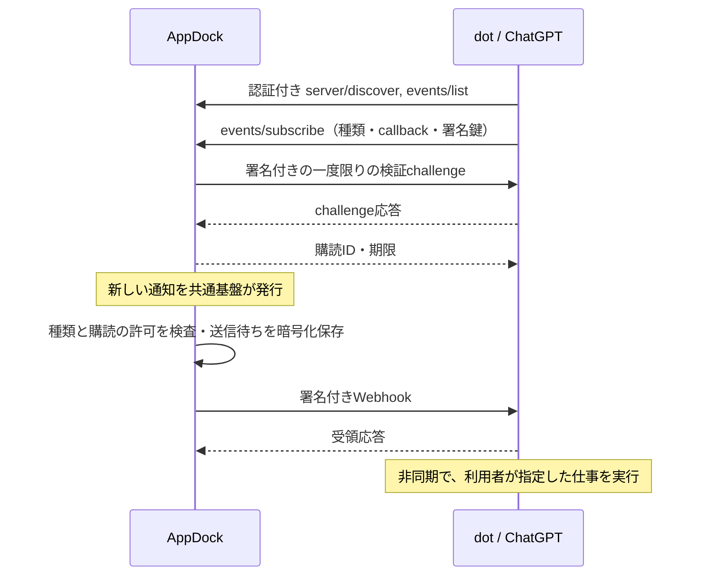

# MCP Eventsと通知連携

最終確認: 2026-10-16。AppDock 0.54.0の実装設計。ローカル検証と実際のdotでの受信確認は[検証記録](../VERIFICATION.md)で区別する。

## 目的と利用条件

AppDockで新しい通知が発生したとき、利用者が選んだ通知種類だけをMCP Eventsで配信し、購読したdotに利用者が指定した仕事を開始してもらう。Gmail等の個別AppletへChatGPT固有の送信処理を追加せず、共通の通知発行口を利用する。

OpenAIの[公式MCP Events仕様](https://developers.openai.com/plugins/build/mcp-events)はdots、ChatGPT webのWork、デスクトップのWork/Cloudを対応先としている。MCP 2.0（`2026-07-28`）とWebhook配信を要求する。任意のチャットIDへ一方的に投稿するAPIではなく、購読時にChatGPTが発行したcallbackへ配信する。監視対象と到着時の仕事はdot側で利用者が指示する。

実利用には次の条件が必要になる。

- AppDockが起動し、MCP連携が有効である。
- 通知設定で対象種類の「MCP Events」をONにしてある。初期値はOFF。
- ChatGPTから購読・更新・解除のためにAppDockの認証付きMCPへ到達できる。
- AppDockから公開HTTPS callbackへ接続できる。
- ChatGPT側でプラグインを再スキャンし、dotでイベントの監視を登録する。アカウント・ワークスペースの利用条件に従う。

ローカルMCPをChatGPTへ接続する公式の選択肢は[Secure MCP Tunnel](https://developers.openai.com/api/docs/guides/secure-mcp-tunnels)または公開HTTPS endpoint。[接続手順](https://developers.openai.com/plugins/deploy/connect-chatgpt)を参照する。TunnelにはPlatform上のtunnel、runtime key、対象ChatGPT workspaceとの関連付け、動作中のtunnel-clientが必要。MCP Eventsとの組合せは実際の環境で購読から到着まで確認する。本変更はTunnelの導入、ネットワーク公開、認証・実利用設定の変更を行わない。

LAN/tailnet接続だけでクラウドからの到達を保証しない。既存のHost/Origin/Bearer検査を保持し、リバースプロキシを使う場合も適切な転送を個別に確認する。

## データの流れ

HTTPの2xxはWebhookの受領を表し、dotの仕事の完了を表さない。即時実行の時刻も保証しない。配信到着と実行結果はdot側で確認する。

## 通知設定と発行

`NotificationPreference.mcpEvents?: boolean`を既存の通知種類別設定へ追加する。保存先は共有settings.jsonのnotificationPreferences.overrides。既存の即時保存・型検証・変更競合処理を利用する。

- UIは通知先の選択肢に「MCP Events」を追加する。送信内容がタイトルと本文であることを表示する。
- 「通知センターのみ」は既存の通知先・読み上げと一緒にMCP EventsもOFFにする。必須バナー等の既存制約は保持する。
- 通知種類のON/OFFは購読先の選択と別。ONでも購読がなければ送信しない。
- `TypedNotifications.options.published`から連携する。表示変更、既読、期限変更、同じdedupeKeyの更新だけでは再配信しない。新しい通知episodeは新しいイベントとなる。
- 過去の通知・履歴をON変更時にまとめて送らない。未宣言の通知種類や停止済みgenerationの発行は既存基盤で拒否される。
- 既存の読み上げも同じ発行口で呼ぶ。デスクトップ/Windows/バナー表示、通知本文、Applet SDKの呼出し契約は変更しない。

全PCが共有設定を受け取っても、購読・認証・送信待ちはPC専用。複数PCで同じ通知を監視するとそれぞれから配信され得るので、監視元PCは利用者が選ぶ。

## MCP契約

同じ`/mcp` endpointで従来のSDKによるinitialize方式と、`2026-07-28`方式を併存させる。旧Codex接続の登録TOML・トークン・操作許可を変更しない。

`mcp-modern.ts`はmodern要求を識別し、要求単位のprotocolVersion/clientCapabilities、HTTPのMCP-Protocol-Version/Mcp-Method/Mcp-Name一致、JSON-RPC構造、Content-Type/Accept、要求サイズ、同時要求上限を検査する。成功応答へ`resultType: complete`とserverInfoを付ける。未対応メソッドは404/-32601、header不一致は400/-32020、未対応版は400/-32022。tools/callは旧接続と同じAPI・許可・入力検証・監査処理を通る。

| メソッド | 役割 |
| --- | --- |
| server/discover | 版、tools/events capability、サーバー情報を返す |
| events/list | 選択された通知種類があるときだけイベント定義を返す |
| events/subscribe | 通知種類、所有者、callback、署名鍵、期限を検証して登録または更新 |
| events/unsubscribe | 同じ主体・通知種類・callbackの購読を解除。繰返し可能 |

イベント名は`appdock.notification.created`。購読argumentsは`ownerKind`（host/applet）、`ownerId`、`typeId`の3項目を必須とし、それ以外を拒否する。events/listの説明へ選択可能な種類名とIDを含める。新規登録は現在ONの種類に限る。同じ主体・種類・callbackの有効な既存購読は、OFF中も更新できる。

payloadのdataは上記3項目と`notificationId`、`title`、`body`だけ。generation、実行コマンド、ファイルパス、認証情報、callback、署名鍵は含めない。タイトル・本文に元々含まれる情報は送信されるので、メール等は送信する種類を選んで利用する。本文は外部由来のデータとして扱い、dotへの行動指示は埋め込まない。

## 購読の寿命

- 認証主体は現在のBearer tokenのSHA-256。既存の「同じtokenを持つクライアントは同じ主体」という契約に従う。
- 購読IDは主体・正規化callback URL・イベント名・フィールド順を固定したargumentsから決定する。キー順が異なっても重複作成しない。
- 既定期限24時間、最大7日、最短60秒。ttlMs:nullにも有限期限を返す。返却するrefreshBeforeまでにChatGPTが同じ購読を更新する。
- 最大64購読。OFF中の有効な購読も上限に含める。期限切れ・主体変更の購読は削除する。
- 種類をOFFにすると購読を保持したまま送信を止め、その種類の送信待ち（再送待ちを含む）を破棄する。OFF中の新規通知は蓄積しない。「通知センターのみ」によるOFFも同じ扱い。
- ONに戻すと、有効な購読へ以後の新しい通知から配信する。再起動しても同じ扱いで、OFF前やOFF中の通知はまとめて送らない。
- OFF中も同じ有効購読の期限・署名鍵を更新できる。callback検証は従来どおり行うため、更新時の検証challengeはOFF中も送信する。新しいcallbackへの登録や期限切れ購読の再登録にはONが必要。
- MCP無効化・token再発行・events/unsubscribeでは購読と送信待ちを取り消す。送信先の410応答による取消も維持する。
- 非同期callback検証中に許可が変わった場合、古い検証結果から購読を作らない。
- OFFへの切替で進行中の送信を中断し、古い送信結果からキューを復元しない。切替前に送信先が受領済みの通知は取り消せない。
- cursorは常にnull。停止中や未購読時に発生した通知の履歴replayは提供しない。期限切れ後の再登録で旧送信待ちを復活させない。

## Webhookと通信保護

`mcp-event-webhook.ts`がHTTPS POSTを担当する。callback検証と通知配信の両方に同じ処理を使う。

- HTTPS限定、URL内の資格情報とfragmentを拒否。接続ごとにDNSを解決し、全候補が公開アドレスか検査する。検査したアドレスへ接続を固定し、元のhostnameでTLS証明書を検査する。自動redirectは行わない。
- loopback、プライベート、link-local、CGNAT、予約・文書用・multicast等のIPを拒否する。IPv6はglobal unicast範囲に限定し、mapped/移行・文書用等も除外する。通常の公開callbackを対象とし、特殊な予約アドレスの例外は設けない。
- DNS解決を含め要求期限10秒、応答本文16KiB、送信本文256KiBまで。
- whsec_付きbase64鍵を24〜64bytesへ検証。HMAC-SHA256でStandard Webhooksの`id.timestamp.body`を署名する。JSONは一度だけシリアライズし、署名対象と送信bytesを一致させる。
- 検証challengeは要求ごとのUUID。2xxとchallengeの定時間比較を満たすまで保存・配信しない。成功検証は主体・callback・鍵の組ごとに最大5分キャッシュし、64件に制限する。
- 鍵更新時は5分間、新旧の署名を併記する。

## 保存と再送

PC専用rootの`automation-events.json`へ購読と送信待ちをまとめて保存する。Electron safeStorageで内容全体を暗号化し、既存atomicWriteで置換する。共有data/settingsや登録TOMLへcallback/署名鍵を書かない。再起動後も購読期限を保持し、送信待ちは現在ONかつ有効な購読の分だけ再開する。保存形式と設定項目は変更しない。旧版でOFFにして既に削除された購読は復元しないため、その場合はONにして再登録する。

最大256送信待ち。新規通知を購読ごとにキューへ入れ、保存できてから送る。1要求ずつ配信し、イベントIDと発生時刻は再送でも保持する。署名時刻・署名は各試行で更新する。

- 2xxで受領済みとして削除。
- 通信失敗・408・429・5xxは指数backoffで最大5試行。その他の3xx/4xx、特に413は再送せず削除。
- 410は該当購読と送信待ちを削除。
- キュー満杯、最終配信失敗、保存失敗は安全なcodeだけをログへ残し、共通エラー通知へ接続する。同じcodeの通知は起動中に一度だけとし、エラー通知自身の配信失敗から通知ループを作らない。
- 保存失敗・破損読込時はイベント機能を停止し、破損ファイルを上書きしない。復旧後にAppDockを再起動し、dotの購読状態を確認する。

受領直後・保存直前の異常終了では同じIDが再送され得る。完全な一度限りの配送は保証せず、dotが使う変更ツールも冪等にする。dotの操作で新しい対象通知が発生する循環は監視対象・仕事の指示で避ける。通知の更新だけでは再配信しないことも循環低減に利用する。

## 実装箇所と検証

- `src/main/core/mcp-events.ts`: 購読、暗号化保存、キュー、寿命。
- `src/main/core/mcp-event-webhook.ts`: URL/IP/署名/HTTPS送信。
- `src/main/core/mcp-modern.ts`: MCP 2.0の要求・応答。
- `automation.ts` / `automation-mcp.ts`: 既存認証・起動寿命と統合。
- `index.ts` / `NotificationSettings.tsx` / `notification-types.ts`: 通知発行、選択、即時保存。
- `tests/mcp-events.test.cjs`: callback検証、署名、再送、取消、再起動、保護と旧方式互換。
- `scripts/mcp-events-ui-test.cjs`: 隔離profileで設定変更、MCP discovery、再起動、通知センターのみ、配布EXEとのhash照合。

実際のdotで完了とする条件は、プラグイン再スキャン→購読→challenge成功→該当通知のWebhook 2xx→dotの起動と指示どおりの処理→監視解除後の停止を確認すること。fixtureでの成功をこの実利用確認へ読み替えない。
