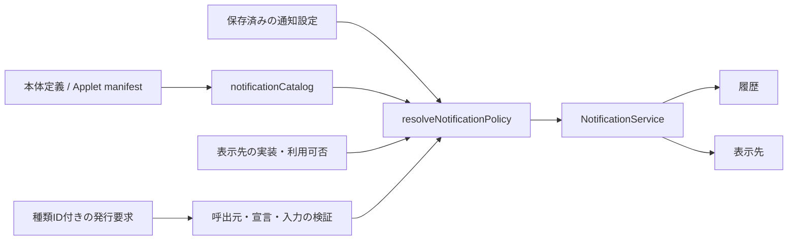

# 通知基盤とDefault Shellへの移行設計

状態: 段階1を本体0.29.0、段階2を本体0.30.0、段階3を本体0.31.0として実装済み。段階4以降は未実装。現行の型・bridge・保存契約は[通知基盤](notifications.md)、実測と制約は[検証記録](../VERIFICATION.md)を正本とする。本書は今回確定した設計と次の実装範囲を記す。

設定は将来、未保存状態を管理しない即時保存へ移行する。今回の未保存警告は通知基盤の最初の発行元であり、基盤の前提にはしない。通知センターなどの追加と即時保存化は独立して進める。

## 要件と設計判断

調査時の0.28.2では未保存バナーが本体専用renderer/View/preloadに属していた。今回、その専用経路を撤去し、Default Shellと追加Shellが同じ公開契約で描画するnotification.bannerへ移した。

レベル、操作、寿命、表示先指定、履歴、複数表示という要求は整合する。通知を表示先ごとに作り直さず、サービスが1件のID・状態・期限を所有し、表示先はその射影を描く。非表示、配送失敗、OSの消去と業務上の解消を分離する。

| 段階 | 状態 | 対象 |
| --- | --- | --- |
| 1 | 実装済み | 通知サービス、操作管理、履歴保存、複数バナー、Default Shell、既存未保存警告の接続 |
| 2 | 実装済み | 種類カタログ、通知設定、方針解決、Node/.NETの最小種類指定API |
| 3 | 実装済み | 通知センター、active/履歴一覧、既読、検索、終了履歴削除 |
| 4・次回の推奨範囲 | 未実装 | トレイ付近の独自デスクトップ通知、表示先adapterの拡張 |
| 5 | 未実装 | Windows表示先、旧通知APIの基盤への接続 |
| 独立した移行 | 未実装 | 設定の即時保存、未保存警告発行元の削除 |

種類別の通知方針を共通化するため、通知設定を通知センターより先に実装する。段階4・5の順序は変更可能だが、Windows側で保持・操作を表現できない通知の閲覧先として段階3のセンターを前提にする。未実装の表示先を製品UIで選択可能にせず、新APIをMCPへ自動公開しない。

## 実装済みの構成

| 実装 | 責務 |
| --- | --- |
| [TypedNotifications](../src/main/core/typed-notifications.ts) | 種類の検証、保存済み方針の適用、episode/世代の対応、設定変更と停止時の撤回 |
| [NotificationService](../src/main/core/notification-service.ts) | Electron非依存の通知ID/revision、期限、所有者内集約、状態遷移、操作関数・要求ID・通知単位ロック |
| [NotificationHistoryStore](../src/main/core/notification-history.ts) | 安全な履歴の投影、読込・原子的保存、保持上限、破損・未知schema時の退避 |
| [NotificationBannerController](../src/main/core/notification-banner-controller.ts) | バナーモデル、表示中通知の操作受付、配送状態 |
| [NotificationBannerHost](../src/main/core/notification-banner-host.ts) | 非モーダルView、provider解決、接続/ready、寸法・zoom・重なり順、Shell切替・復旧 |
| [Default Shell](../shells/default/notifications.tsx) | プレーンテキスト、操作、縦スタック、展開・スクロール、キーボード・読み上げ |
| [SettingsNotificationSource](../src/main/core/settings-notification-source.ts) | 設定の通知条件、文言、保存/破棄/編集へ戻る処理、表示文脈 |

SettingsEditingSession→SettingsNotificationSource→TypedNotifications→NotificationService→BannerController→BannerHost→Shellという接続とし、サービスから履歴ストアへ安全な記録を投影する。操作管理はサービス内部に実装した。別のNotificationActionRegistryクラスは作っていない。

本体からDefault ShellのReact部品をimportせず、復旧時にも同じDefault Shell entryを使用する。[Shell基盤](shell-foundation.md)に従い、内容ControllerとネイティブViewの寿命を分離する。dirty、draft、保存/破棄という操作種別、SettingsEditingSessionへの参照は汎用サービスへ置かない。設定固有の接続は削除可能な発行元へ閉じ込める。

## 実装済みの通知と操作契約

型は [src/shared/notifications.ts](../src/shared/notifications.ts)、発行入力はNotificationInputを正本とする。

| 項目 | 現行契約 |
| --- | --- |
| id / revision | ホスト発行IDと内容更新番号。複数表示先へ拡張しても通知は1件 |
| source / dedupeKey | 信頼された本体呼出元が指定する所有者と、その所有者内の安定キー |
| level | info / warning / error |
| title / body | 最大200文字/2,000文字のプレーンテキスト。HTML不可 |
| actions | 最大3件。発行元は安定key/label/primary/disabled/runを指定し、Shellには不透明なidのみ渡す |
| lifetime | timed / manual / condition。timedは1〜2,147,483,647ms |
| dismissible / busy | 全体dismissの許可と操作中状態。conditionはdismissible:false |
| targets | 現行受付はbannerまたは空配列。型のdesktop/windowsは将来用で、受付時に拒否 |
| history / historyText | persistent / session / none。persistentには安全な保存用title/bodyが必須 |
| status | active / resolved / dismissed / expired / withdrawn / interrupted |
| delivery | 表示先ごとのpending / showing / hidden / failed / ended |
| read | falseで作成し、通知センターから明示的に既読にする。解消・期限変更とは独立 |

空targetsは表示なしで管理できる内部契約。段階1には閲覧ページがないため、製品通知の唯一のユーザー導線にはしない。段階3では通知センターだけに表示する通知として使用する。

同じ所有者・キーのactive通知は同じIDで更新し、終了後の再発は新IDになる。同一通知のhistory方針は変更できない。通常更新はtimedの期限を延長せず、restartTimerを明示した場合に受付時刻から再設定する。期限はmainで実時間として管理し、非表示時間も進み、期限・一覧・操作を再照合する。

内部APIはupsert/list/bannerItems/historyEntries/end/withdrawSource/invoke/subscribe等で構成する。endは発行元がresolved/withdrawnを指定する。Shellへ関数、任意コマンド、任意URL、設定値を渡さない。

操作要求はnotificationId/revision/requestId/typeと、invoke時のactionIdを持つ。BannerHostはWebContents/mainFrame/URL/現sessionを、Controllerは表示中の通知を、Serviceはactive/revision/操作ID/busyを検査する。要求IDを最大512件保持し、同じ内容の再送には同じ結果を返す。違う内容での再利用は拒否する。この重複排除は起動中の有限キャッシュであり、再起動をまたぐexactly-once保証ではない。

通知単位のロックで別要求からの同時押下も防ぐ。ボタンを押しただけでは解消せず、発行元が成功後にendする。失敗・確認キャンセルは通知を維持し、再試行は新しい要求IDで行う。終了時に操作関数を回収し、開始済み副作用を巻き戻さない。遅い完了で終了通知を再表示しない。

アクティブ上限は全体200件/所有者50件。本体以外の新規受付は全体180件までとし、本体用20件を確保する。同一キー更新は上限到達時も可能。現在は内部sourceのhost.接頭辞で本体を区別する。外部公開時は呼出元がこの識別を偽装できないadapterを追加する。

## 実装済みのバナー

Shell領域はnotification.banner、bridgeはwindow.appdockNotifications。minimumHostVersion:0.29.0以上の追加Shellが通知領域だけを提供でき、未提供/故障領域はDefault Shellへ戻る。モデルはschemaVersion/contextId/sessionId/revision/dark/items/viewport、APIはconnect/ready/onChanged/act/resize/onFocus/focusHostと自Applet用共通Shell API。実際の署名は[現行契約](notifications.md#shellの領域とbridge)を参照する。

既存OverlayHostはモーダル1件・入力停止・route変更取消という契約のため共用しない。バナーはroute変更でも通知IDを維持する。小さな独立ViewをWindow上部48 CSS pxに置き、本文を押し下げず、ページ/WebのViewより上、モーダルより下へ再配置する。

幅最大680 CSS px、左右余白16 CSS px、利用可能高さ40%を上限の目安とし、zoomとDIPへ変換する。発行順に縦スタックし、3件を超える分は「ほかN件を表示」で展開して領域内スクロールする。更新やレベル変化で並び替えない。

新規通知でfocusを奪わず、タイトルバーの「通知」で明示移動する。Escape/Tab境界で元のViewへ戻る。色・アイコン・レベル名と新規通知の読み上げを持つ。スクリーンリーダーと物理DPI/IMEの実機確認は検証記録の未確認事項として残す。

ready期限10秒。切替先のreadyまでは旧Viewを保持し、サービス側の期限・操作ロックは交換しない。故障した同provider/版を起動中に記憶し、明示再試行/新版で再評価する。safe起動はDefault Shellへ固定する。Default Shellも利用不能なら最小ネイティブdialog/ログを使用し、壊れた通知基盤へ故障通知を再発行しない。

バナーの×はdismissible通知全体を終了する操作。ページやWindowの非表示はdismissではない。条件の解消、全体dismiss、期限切れは将来の全表示先にも終了を要求する。

## 実装済みの設定発行元

未保存期間をhost.settings内の固定キーで1通知へ集約する。通常はwarning「未保存の変更があります」、parseError/saveError時は同じ通知をerrorへ更新する。すべて保存、確認付き全体破棄、直前の設定/Applet編集画面へ戻る操作を持つ。

保存/破棄はrendererとShellの入力反映待ち、および最新SettingsEditingSession/editRevision/operationIdを使う。保存成功・破棄確定・既存操作での未保存解消はresolved、保存失敗・確認キャンセルは維持する。設定/AppletページではbannerVisibleだけをfalseにし、通知はactiveのまま保持する。×や自動消去は発行元として指定しない。

draft、設定JSON、画像を通知へ複製せず、永続履歴は安全な固定要約だけを保存する。既存host.notificationsのApplet通知スイッチでこの警告を無効化しない。旧SettingsNotice renderer/View/preload/IPC/CSSは除去済み。

## 実装済みの履歴と再起動

PC専用dataDirectory配下のnotifications/history.jsonにschemaVersion:1を保存する。共有settings.jsonへ混ぜず、[設定同期の配置別root](settings-sync.md)に従う。保存ファイル追加のため本体を0.29.0へマイナー更新した。

persistentは画面用詳細と別の安全なtitle/body、ID/source/レベル/時刻/終状態/read/targets/deliveryを保存する。callback、操作ID、認証情報、draft、生の例外を保存しない。sessionは起動中だけ、noneはactive終了時に削除する。終了済みメモリー記録は最大1,000件。

永続終了履歴は30日/1,000件/5MiBの上限で古い記録から整理し、activeを保持期限で解消しない。150msの集約とtempからの原子的置換を使う。保存不能でも通知・操作を継続しログへ記録する。破損は.corrupt-UUIDへ隔離、未知schemaは上書きせずメモリー運用に退避する。監査ログではなく、障害直前の未flush更新の保存は保証しない。

再起動時の過去activeはinterruptedとし、操作を復元しない。現在の発行元が条件を再評価して新IDで通知する。現在のhistoryEntriesは保存ストアとsession記録の内部取得口であり、通知センターの一覧・検索・既読・削除APIはまだない。

## 段階2: 通知種類カタログと通知設定

この段階を通知センターより先に実装する。種類・既定値・ユーザー設定を解決する共通処理はすべての表示先の前提になり、履歴画面がなくてもバナーで検証できる。通知センターだけに表示する選択は段階3で追加した。以下は0.30.0の実装契約。次回は段階4の独自デスクトップ通知を実装する。

### 妥当性と補完

要求の「通知の一覧」は、発生した通知や履歴ではなく、発行元が提供する**通知の種類の一覧**とする。発生履歴から種類を推測すると、まだ発生していない通知を設定できず、可変の件名やアカウント名ごとに設定が増えるため、安定した種類IDを事前宣言する。

| 要求 | 採用する仕様 |
| --- | --- |
| AppDockとAppletの通知を種類別に設定 | 本体定義とApplet manifestの静的宣言を同じカタログへ取り込む |
| オン/オフ | 種類が許可する場合のみ変更可能。必須通知は理由を表示してオンに固定 |
| 複数の通知先 | 種類の許可先と本体で実装済みの表示先から複数選択。1件の通知IDで同時配送 |
| 時限通知の表示時間 | 時間を調整できる種類に秒数入力を提供。空欄は自動消去なし（manual） |
| 未保存警告など | conditionを維持。時間変更で解消条件を置き換えず、無効化も許可しない |
| 設定の保存 | 共有settings.jsonの設定として既存編集・保存へ統合し、通知専用の未保存管理を新設しない |

「設定値の上書きがない」と「表示時間を空欄にした」を区別する。前者は発行元の既定値を使い、その実効値をUIに表示する。後者は明示的なnullとして保存し、既定秒数へ戻さずmanualにする。発行元の既定時間自体が未指定の場合もmanualにする。

### カタログと発行元の識別

独立したRegistryクラスは作らず、既存Applet discoveryでnotificationTypesを検証し、sharedのnotificationCatalogで本体定義とmanifest宣言を集約する。設定画面を開くためにAppletを起動しない。無効/停止中でも定義を表示し、設定変更は可能とする。不正manifestは既存の導入エラー/ホストログで説明し、種類を推測して登録しない。

キーはownerKind（host/applet）、ownerId、typeIdの組とする。実通知のid、起動世代、表示名、文面、配列位置から作らない。識別子をドットで分割せず構造化して扱い、本体と同じIDを名乗るAppletも別の名前空間に置く。所有者は呼出元の認証情報からホストが決定する。

定義はsharedのNotificationTypeDefinition、所有者/表示名/状態を伴う一覧はNotificationTypeEntryとする。正本は[notification-types.ts](../src/shared/notification-types.ts)。

| 定義 | 意味 |
| --- | --- |
| typeId / title / description | 所有者内で安定したID、設定用の名前と説明。動的な通知本文を含めない |
| levels / defaultLevel | この種類が取り得るinfo/warning/errorと既定レベル。発行時の指定もこの範囲で検査し、レベルからオン/オフ可否を推測しない |
| defaultEnabled / canDisable / disabledControlReason | 既定の有効状態、ユーザーによる無効化可否、変更不可の説明 |
| allowedTargets / defaultTargets / requiredTargets | 選択可能先、既定の選択、外せない先。requiredはallowedの部分集合 |
| lifetimePolicy | userDuration、fixedManual、conditionのいずれか |
| defaultDurationSeconds | userDurationだけに適用する既定秒数。未指定/nullならmanual |
| history | persistent/session/none。初回は発行元の固定方針とし、この画面の編集項目にはしない |

userDurationは時間を設定すればtimed、空欄ならmanualになり、どちらもdismissible:trueにする。fixedManualは時間欄を出さずmanual/dismissible:true、conditionはdismissible:falseとし発行元による解消/撤回だけで終了する。ユーザーが閉じられず自動終了もしない通知を、時間調整によって作れないようにする。

canDisable:falseは本体が必須と認めた通知だけに許可する。Appletの自己申告だけで必須化させない。必須通知には少なくとも1つのrequiredTargetと理由が必要で、無効化や全表示先の解除による迂回を拒否する。本体の未保存通知はhost/settings/unsaved-changesという構造化キーとし、warning/error、必須banner、conditionにする。将来この発行元を削除しても他種類の設定には影響しない。

同じ意味の種類はアップデートでもIDを維持する。名称変更だけでユーザー設定を失わない。違う意味の通知へIDを再利用しない。種類の追加/削除・制約変更は既存snapshot/設定ページrevisionと方針のfingerprintで検出する。独立したcatalogRevisionは公開しない。宣言重複や矛盾した既定値は登録時に拒否する。初期上限は1発行元64種類、設定上書き合計1,024件とし、既存manifest/settingsのサイズ制限も適用する。

### 設定ページとDefault Shell

設定インデックスに本体カテゴリ「通知」（pageId:notifications）を追加し、既存page.settingsのモデルとDefault Shellへ組み込む。新しい独立Windowや通知設定専用Shell領域は追加しない。本体がカタログ・実効値・操作可否・変更不可理由を投影し、追加Shellも同じ契約を使う。

一覧は「AppDock」とAppletごとのグループに分ける。Applet順は既存設定インデックスの順序に合わせる。各種類に名前・説明、発行元の状態、有効スイッチ、通知先のチェックボックス、対象種類だけに時間欄と「既定に戻す」を表示する。件名・直近本文・履歴件数の一覧は通知センターの責務に残す。

画面例の構造:

- Appletからの通知を許可（既存共通スイッチ）
- AppDock
  - 未保存の変更: 常に有効 / バナー固定 / 問題が解消するまで表示
- 各Applet
  - 宣言された種類: 有効 / バナー等の複数選択 / 自動消去までの秒数または時間制限なし

時間は整数秒で1〜86,400秒（24時間）を初期の入力範囲とする。0・負数・小数・NaNを「時間制限なし」の別表現として認めない。空欄は「閉じるまで表示」と明示する。設定上の秒数は通知受付からの寿命であり、初めて描画されてからの滞在時間ではない。複数表示先で共通のexpiresAtを使う。

種類名・発行元・説明を既存の設定横断検索へ追加し、選択時は対象の行へ移動する。右本文専用の別検索を増やさない。安定キーから検索項目IDとアンカーを作り、無効化/初期値復元/外部受信でスクロールやfocusを奪わない。

時間欄の入力途中や不正な値は、既存設定編集セッションが保持する。画面上の変更を配送へ先行適用せず、正常に保存された値だけを使う。将来の即時保存化ではこの保存入口を切り替え、notificationCatalog/resolveNotificationPolicy/NotificationServiceはそのまま使う。通知カテゴリだけに別の保存ファイルや独自draftを作らない。

### 保存形式と設定解決

設定はユーザーが選ぶ共通の通知方針としてEXE隣のsettings.jsonへ置き、履歴・配送状態・表示先の利用可否はPC専用とする。フィールドnotificationPreferencesは任意追加で、省略時は上書きなしとする。共有ファイルの既存schemaVersion:1との読み取り互換を保つ。設定項目追加のため本体を0.30.0へマイナー更新した。

以下は現在の保存形式の例。宣言済みの所有者/種類に対して適用する。

```json
{
  "notificationPreferences": {
    "overrides": [
      {
        "ownerKind": "applet",
        "ownerId": "example.mail",
        "typeId": "new-message",
        "enabled": true,
        "targets": ["banner"],
        "durationSeconds": null
      }
    ]
  }
}
```

上書き行のenabled/targets/durationSecondsはそれぞれ省略可能。省略はその項目の既定値を継承し、durationSeconds:nullだけが明示的なmanual指定になる。「既定に戻す」は対象行を削除し、全体設定や他種類を初期化しない。同じ組キーの重複、型不正、任意プロパティ、範囲外秒数は保存時に拒否する。targetsはbanner/desktop/windowsの既知識別子を受け付け、未実装と未知の識別子を区別する。未知の文字列は入力エラーにする。

型が正しい未導入Applet/削除済み種類の上書きは同期・再導入に備えて保持し、「現在利用できない種類」に分ける。存在しない宣言をその上書きから登録しない。IDが変わる移行は発行元の明示対応表で行う。カタログの制約変更で設定が適用できなくなった場合も保存値を無断で書き換えず、実効値と理由を表示する。

resolveNotificationPolicyをElectron非依存のshared関数として実装した。カタログ定義、保存済み設定、Applet共通スイッチ、表示先の利用可否から実効enabled/targets/lifetimeを計算する。発行元やShellが同じ計算を複製しない。



解決順は、呼出元/種類の検証→種類の既定値→ユーザー上書き→種類の制約と共通スイッチ→利用可能先→受付上限。違反するローカル保存は拒否する。同期で届いた値は構造を検証して保持し、PCにない表示先や新しい種類を理由に全設定を破棄しない。適用できない値は理由付きで無効化し、必須通知の制約は本体定義で守る。別の表示先へ無断で代替配送しない。

on/offと寿命の判断は実通知を作る前に行い、未保存のUI値を読まない。実通知には型の識別子と適用済み方針を結び付ける。dedupeの範囲を（owner、typeId、dedupeKey）とし、同じAppletの異なる種類を誤集約しない。受付上限の「所有者50件」は種類別ではなくApplet全体で共有し、種類を増やして上限を迂回できないようにする。

設定カタログ、部分JSON、検索、Default Shell、SettingsStoreの受信・保存・revision検査を同時に拡張する。通知の種類定義は実行コード/manifestから得て、可変のコピーを設定へ保存しない。履歴のtypeId等は表示用の識別情報として追加し、保存schemaの互換を判定する。古い履歴は「種類不明」として読めるようにし、文面から推測して分類しない。callbackや操作IDを永続化しない契約を維持する。

### 無効化、配送先、設定変更の適用

| 操作・状態 | 適用 |
| --- | --- |
| 種類がオフ / Applet共通スイッチがオフ | 新規通知のID・active・通常履歴を作らず、発行元へsuppressedと理由を返す |
| activeがある種類をオフにして保存 | その種類のactiveをwithdrawn、理由type-disabledまたはapplet-disabledで終了し、全表示先と操作を失効させる。業務条件のresolvedにはしない |
| 再びオンにする | 過去イベント・履歴を再生しない。条件型の発行元には方針変更を知らせ、現在の条件を再評価させる |
| 通知先を保存変更 | activeの同じIDへ適用し、外した先を閉じ、追加した利用可能先へ表示。createdAt/期限/実行ロックを再作成しない |
| 時間を保存変更 | 次に新規受付する通知から適用。既存activeや同じキーの通常更新の期限は変更しない |
| 発行元の明示的な再通知 | ユーザーの現在の方針で解決し直す。再通知を通常更新と区別し、繰返し更新で時間を延長しない |
| 過去の履歴 | 設定変更で削除・再分類・再実行しない |

無効な種類の本文を通常履歴へ残して実質的な通知を続けない。診断に必要な抑制件数/理由は内容を含めず集約し、発生ごとにログを増やさない。すでに存在する終了履歴は保持方針どおり残す。

段階2では実装済みのbannerだけが選択可能。desktop/windowsは未実装と表示する場合も操作不能にし、旧Windows通知が動くことを新しい表示先の実装済みと扱わない。段階3では「通知センターのみ」を明示選択でき、内部ではtargets:[]にする。必須通知のrequiredTargetsは引き続き解除できない。センターはすべてのactive/対象履歴の閲覧口なので、通常の通知先チェックボックスとして二重登録しない。

同期元で選ばれた表示先がこのPCで未対応なら、その選択を保存したまま理由を表示する。利用可能な選択先が1つでもあればそこへ配送し、なければ新規受付はsuppressed:no-available-targetsとする。段階3で明示的にセンターのみを選んだ場合は、センターを利用可能な閲覧先として判定する。既存activeもすべての選択先を失う場合はwithdrawnと理由を記録して終了する。対応先の追加だけで過去イベントを再送しない。必須通知は定義で確保したbannerを保つ。利用可否は実装・設定の対応可否を指し、トレイ格納、ページ非表示、Shellの一時復旧中を利用不能にはしない。受付後の実配送の失敗はdeliveryへ記録し、業務上のresolvedにはしない。

操作中の無効化は通知を終了して新しい操作を拒否するが、開始済みの保存等を巻き戻さない。完了処理で古い通知を復活させない。種類定義や設定の更新時は通知revision/公開モデルを更新し、古い画面からの操作に既存の再検査を適用する。

### 既存スイッチとApplet APIの移行

既存host.notificationsは値と外部操作キーを保持して「通知」カテゴリへ移す。表示名を「Appletからの通知を許可」とし、旧notifications.showと新しいApplet通知の親スイッチにする。本体の必須通知には適用しない。旧デスクトップ通知だけを制御していた範囲が、新SDKのApplet通知では全表示先へ広がることを現行文書・UIに明記する。

親スイッチがオフでも種類別設定を編集できるが、行に「Applet共通設定で停止中」と表示する。親スイッチをオフにして保存した場合も、新APIの全Appletのactiveを種類オフと同じ規則で撤回する。旧APIで既にOSへ送出した通知の即時撤去は、段階5のadapter対応まで保証しない。種類をオンにしただけで親スイッチを自動変更しない。既存MCPのnotifications:booleanも同じ意味へそろえ、通知種類の新しい設定操作をMCPへ自動公開しない。

Appletの種類別設定を実際に機能させるため、従来段階4に置いていた新APIの最小部分を段階2へ前倒しする。Node/.NETの両方で次を同時に用意し、片方だけを対応済みとしない。

- manifestのnotificationTypes宣言と既存notifications capability、最低ホスト版の検査。
- 種類ID付き発行/upsert、所有する通知の解消/撤回、実効方針の取得・変更購読。
- accepted（notificationIdを含む）/suppressed（理由を含む）の結果。acceptedはサービスへの登録であり、表示成功・既読を保証しない。設定による抑制を入力不正や配送失敗と混同しない。
- 所有者と実行世代をホストが付与し、未宣言ID・他AppletのID・停止済み世代・過大入力を拒否する。発行/更新の頻度も所有者単位で制限し、解消/撤回は発行頻度制限で妨げない。受付上限や頻度超過は明示エラーで返す。
- 操作は初期公開では自Appletの登録済みコマンドに限定し、任意URL/コード/他Appletコマンドを渡さない。押下時に同じ実行世代・コマンド所有者を再検査する。

新APIの発行元は文言・安全な保存用要約・dedupeKey・操作を指定し、ユーザー設定を回避するためのenabled/targets/寿命の上書きは指定できない。サービスのraw upsertは本体内部に留める。更新する場合は既存episodeの時間方針を引き継ぎ、時間設定変更を同じキーのupsert経由で遡及適用しない。多数のイベントは発行元が意味のあるdedupeKeyで集約し、manual指定を無断で時限化して受付枠を空けない。停止・異常終了時はその世代のactiveを撤回し、同じApplet IDで再起動した新世代へ古い操作を渡さない。

旧notifications.showは段階5まで従来経路を維持する。種類IDがないため、タイトルから新しい種類へ自動分類しない。設定画面には「旧方式の通知は共通スイッチで制御」と説明し、未宣言の旧通知を種類別制御済みとは表示しない。各Appletが新APIへ移る際はそのAppletの実装・検証・版更新を別途行い、本体の機能追加だけで既存Appletのすべての通知が移行したと扱わない。

### 実装済みの範囲と受入条件

1. 種類定義/カタログ、設定上書きschema、PolicyResolverと結果型を追加する。本体の未保存警告を登録し、旧設定の読み取り互換・種類別dedupe/所有者上限・状態遷移を検証する。
2. SettingsStore/設定カタログ/部分JSON/検索/page.settingsのモデルを拡張し、Default Shellへ「通知」を追加する。時間とtargetsの未保存値を配送へ適用しない。
3. Node/.NETの最小新API、manifest検査、実行世代とコマンド操作を接続する。隔離した両runtimeの発行元で設定による配送/抑制を実証する。
4. オフ可能/必須、複数先の契約、空欄manual・既定継承・数値境界、condition固定、設定変更中のactive/操作競合、同期/再起動/外部revisionを検証する。保存形式の複数先と利用可能先への絞り込みを検証し、未実装の配送成功は扱わない。複数adapterの実配送は段階4・5で検証する。
5. 未発生/停止中/未導入/削除済み種類、親スイッチ、既知の未実装表示先の保持と未知識別子の拒否、検索/初期値復元、Shell差し替え/復旧をGUIで確認する。種類定義のない旧APIが従来どおり動くことも確認する。
6. 現行契約・設定同期・Applet SDK・README・検証記録を更新し、本体と変更したモジュールだけを版更新/publishする。固定単一EXEで種類設定とバナーを確認する。

必須受入条件は、未保存警告をオフ/時限化できないこと、空欄がmanualになること、設定未保存/保存失敗時に配送方針が変わらないこと、Appletが種類や所有者を偽装して設定を迂回できないこと。新規の製品用サンプル通知や動的な種類登録を初期機能へ混ぜない。

段階2の構成補足: TypedNotificationsが種類とepisodeの対応、設定適用、停止時撤回を所有し、既存サービスは期限/操作/履歴を所有する。公開Applet APIはminimumHostVersion:0.30.0とnotifications capabilityを必要とする。発行頻度はApplet単位でバースト20件、毎秒10件補充。endは頻度制限から除外する。履歴はschemaVersion:1を維持しownerKind/ownerId/typeId/endReasonを任意追加、旧記録は種類不明として読める。SDK AssemblyVersion 0.10.0を維持して既存Appletとの共有assembly契約を保つ。

利用可能先は現在bannerのみとし、専用adapter registryは段階4で追加する。通知設定は既存page.settingsのauxiliary.notificationTypesで定義を渡し、共通shared関数でフォーム用の方針を求める。保存制約はmainでも再検査する。同期で保持した適用不能な行を理由に別の設定編集を妨げないよう、意味上の保存制約は変更された上書き行へ適用する。

## 段階3: 通知センター

種類カタログと通知設定の後に、通知センターを独立した本文ページとして追加する。段階2の方針解決を共用し、「通知センターのみ」の設定を有効にする。以下は0.31.0の実装契約。

### ページとShell契約

本体に通知センターへのナビゲーションを追加する。既存タイトルバーの「通知」はバナーへのfocus操作として維持し、センターを開く操作とは区別する。本文領域page.notificationsを追加し、NotificationCenterControllerが一覧・操作を所有し、既存ShellPageHostがView/切替/復旧を所有する。正本は[notification-center.ts](../src/shared/notification-center.ts)。追加Shellの最低ホスト版は0.31.0。ページ表示は同じwindow.appdockPageを使う。

Default Shellと追加Shellへ同じモデル/bridgeを提供する。モデルにはsession/revision/theme、active項目、終了履歴、検索条件、件数、続きを取得するcursorを含める。bridgeは取得/購読、検索・絞込、既読操作、終了履歴削除、active操作を提供する。Shell内でサービスへ直接アクセスせず、mainFrame/URL/sessionの検査と自Applet限定の共通契約を維持する。

### 一覧・既読・操作

- 「アクティブ」と「履歴」を分ける。activeはhistory:noneも含め、同じ通知IDの履歴と重複表示しない。バナー非表示のactiveやtargets空配列もセンターに表示する。
- activeは現在の文言と操作、終了履歴は安全な保存用文言と終了理由を表示する。再起動後のinterruptedや古い記録に操作ボタンを復活させない。
- active操作は既存invokeと通知単位ロックへ接続する。画面間の同時操作、古いrevision、終了との競合を同じ規則で処理する。履歴削除と通知dismissを別操作にする。
- 全体は新しいものから表示する。レベル/発行元/状態/未読、プレーンテキスト検索を提供する。絞込で通知状態を変えず、新着でスクロール/focusを奪わない。
- 開いただけで全件既読にしない。1件/選択範囲/現在の絞込範囲の明示既読を提供し、バナー表示・OS配送とも分離する。既読は通知の解消や期限延長を起こさない。

一覧用にサービスと履歴のID単位統合を追加する。終了履歴にはページ取得と安定した並び順を設け、永続・sessionそれぞれの保持上限に対して、終了履歴を50件単位で表示し、全履歴を毎回描画しない。更新中cursorの失効時は明示再取得する。Service/HistoryStoreに既読と終了記録削除の操作を追加し、persistentは保存、sessionはメモリー更新、noneはactive中だけ更新する。既存のread欄を利用し、段階2で型識別情報を追加した保存schemaとの整合と後方互換を実装時に確認する。

削除対象は指定IDまたは条件に一致する終了記録だけ。主処理の通知解消・設定変更・activeの削除を行わない。単一終了記録の削除は直接実行、範囲/全履歴消去は確認して実行する。終了済み記録がServiceとHistoryStoreの両方に残る場合も一括して取り除き、再表示を防ぐ。削除中に新たに終了した記録まで巻き込まないよう対象IDを確定する。未知schema保護中は保存できない状態を表示し、永続消去成功を返さない。

### 実装順と受入条件

1. ID統合、一覧射影、既読・終了履歴削除・検索/ページ取得をElectron非依存で追加する。
2. 通知センターController、Shell本文領域、Default Shell画面、mainのページ導線を追加する。
3. activeと安全な履歴、空targets、none/session/persistent、バナーとの同時操作をGUIで検証する。
4. 再起動・interrupted、削除後の再表示防止、保存不能/未知schema、Shell切替/故障、検索中の新着とスクロール保持を確認する。
5. 現行契約・README・検証記録を更新し、版更新区分を判断、通常publishと固定EXEを検証する。

この段階では独自デスクトップ/Windows配送を追加しない。段階2の種類指定Applet APIをそのまま使用し、センター表示用の別発行APIを増やさない。通知センターだけの通知が操作可能であること、history:noneがactive中だけ見えること、履歴から終了通知を再実行できないことを必須条件とする。

### 段階3の実装補足

NotificationCenterControllerは既存ShellPageHostへ載せ、リボン「通知センター」とappdock.notifications.openを追加した。タイトルバー「通知」はバナーfocusとして維持する。MCP公開コマンドは追加していない。

Service.centerEntriesはactiveの現在文言と、persistentの安全な履歴/sessionの起動内履歴をIDで統合する。noneはactive中だけ表示する。終了履歴は50件単位、activeは既存上限200件まで表示する。cursorは検索条件と対象ID/revision/既読/状態のhashと次のoffsetを含み、失効時は明示再取得する。主画面を開いただけでは既読にせず、単一/選択/条件範囲の既読を提供する。

単一IDの既読・削除は現在の対象集合/終了状態を再検査し、条件範囲の操作はquery tokenも照合する。削除確認前に対象IDを固定し、確認中に到着した通知を含めない。既読で期限を再設定しない。persistentの編集は同期の原子的保存を確認し、失敗ならメモリーも戻す。未知schemaでは永続編集を拒否して元ファイルを保ち、session/noneの操作は続けられる。操作完了後は同じ公開bridgeで最新モデルを取得し、次の操作を有効にする。

### 更新適用完了バナー

起動時のupdate-result.jsonの成功結果を、host/updates/appliedという種類でTypedNotificationsへ渡す。初期表示先はbanner、info、userDurationの既定6秒、persistent。通知設定でオン/オフ・表示先・時間を変更でき、Applet共通スイッチは適用しない。更新画面への操作を持ち、保存用文言にパスや更新jobを含めない。

PC専用notifications/update-receipt.jsonにschemaVersion:1と成功結果bytesのSHA256を原子的保存し、同じ結果を通常再起動で再通知しない。抑制した成功結果も受付済みにし、履歴削除で受付済み記録を消さない。保存不能時は再表示の可能性をログで知らせ、未知schemaは上書きしない。表示/既読との完全な原子的保証ではなく、結果受付の記録である。失敗結果・更新進捗/確認結果は既存更新処理を維持する。

## 段階4: 独自デスクトップ通知

段階2の表示先利用可否と方針解決にデスクトップadapterを追加し、サービスから表示・更新・終了を要求し、adapterから配送状態を返す。現在のsetBannerDeliveryも共通adapter契約へ接続する。種類設定でdesktopを選択可能にし、必須/許可先と保存済みの秒数を共用する。通知の終状態と表示先の状態は別のまま保持する。未対応、抑制、失敗の理由をモデルに追加する場合は共有型・履歴読込との互換を同時に更新する。

本体が専用Windowを管理し、Shellの候補領域notification.desktopがカードを描く。View寿命と内容Controllerを分離し、Default Shell内でカード表現を共用できる。通知ID・期限・操作要求とロックをバナー/センターと共有し、新規表示でfocusを奪わない。

トレイ座標を取得できればその作業領域内に配置し、取れなければ選定した画面の作業領域端へ置く。複数通知は積み、超過分はセンターへ到達する導線を設ける。タスクバー方向、DPI/複数画面、画面変更、全画面/ロック時の抑制、クリック時のfocus方針は実装前に実機条件で確定する。抑制中もtimed期限は進み、抑制解除を理由に終了通知を再表示しない。

## 段階5: Windows通知と旧APIの基盤統合

既存の [notifications.ts](../src/main/core/notifications.ts) と [notification-routing.ts](../src/main/core/notification-routing.ts) は現段階で別経路を維持している。段階5でWindows adapterへ接続し、portable用protocol、配置/profile識別、クリック起動の安全性を保つ。

旧notifications.show(title, body, options)は通知設定/silent/command/戻り値を保つadapterとして移行する。種類IDのない呼出しは発行元ごとの明示された「旧方式の通知」種類へまとめ、本文から種類を推定しない。host.notificationsと種類別設定の両方を適用し、旧呼出元へは従来の戻り値を維持する。OS受付・ユーザー既読・条件解消を混同しない。Windows側で表現できないボタン/期限/撤去は通知センターへ案内し、別表示先へ無断配送しない。古い起動世代のクリックから失効した操作を実行せず、履歴のcallbackを復元しない。固定Electron版と実Windowsの配送・クリック・再起動で能力差を検証する。設定された秒数は基盤の通知寿命として扱い、Windowsのポップアップ表示時間やmanual指定時の常時表示を保証しない。OS側で消えても基盤がactiveなら通知センターで閲覧/操作できる。この違いを表示先選択の説明に含める。

段階2のNode/.NET APIの所有者・起動世代・capability・操作検査をWindows adapterにも適用する。表示先を増やしても別Appletの履歴・操作を公開せず、新しいraw配送経路で設定を迂回しない。portableの起動先をソースfixtureだけで検証済みとせず、固定EXEと実Windows通知のクリックで確認する。MCP公開は別途要求された範囲のみとする。

## 即時保存への独立した移行

移行済み機能では通常の変更ごとに未保存警告や「保存しました」を出さない。該当発行接続を外して旧条件通知をwithdrawnにし、全設定移行後にSettingsNotificationSourceを削除する。通知サービス、履歴、Shell、表示先は作り直さない。

必要な通知は保存失敗や追加操作が必要な場合に限定する。再試行可能なら保存サービス所有の操作を渡し、成功後にresolveする。再試行する値と処理は保存サービスが所有し、通知へコピーして別の未保存管理を作らない。入力途中/バリデーション、保存失敗時の値と画面、外部同期競合は即時保存の別設計で確定する。

## 検証と実装時の補足

今回の受入確認は汎用発行元の状態・期限・履歴・操作競合、複数表示/スクロール/focus、Shell切替/復旧、設定の入力反映待ち/保存/破棄/失敗保持、モーダルとの重なり順、固定単一EXEを対象にした。試験の範囲と未確認事項を[検証記録](../VERIFICATION.md)で区別する。後続段階では既存回帰を維持し、上記の段階別受入条件を追加する。

段階1の実装時、開発ドライブの祖先ボリュームマウントで更新packが失敗したため、Windows登録済み祖先マウントを認識した。段階3の実更新検証で適用/復旧にも同じ影響が見つかり、更新helper全経路へ祖先ボリュームの認識を統一した。入力/出力自身・通常junction祖先・配布物内のリンク/マウント拒否、apply/recover/extractの範囲・ハッシュ検査は維持する。これは通知設計の変更ではなく発行互換性の修正で、詳細は[更新仕様](updates.md)を参照する。通知基盤の大枠は当初設計を維持し、実装上の契約と将来契約を本書で明確に分けた。
