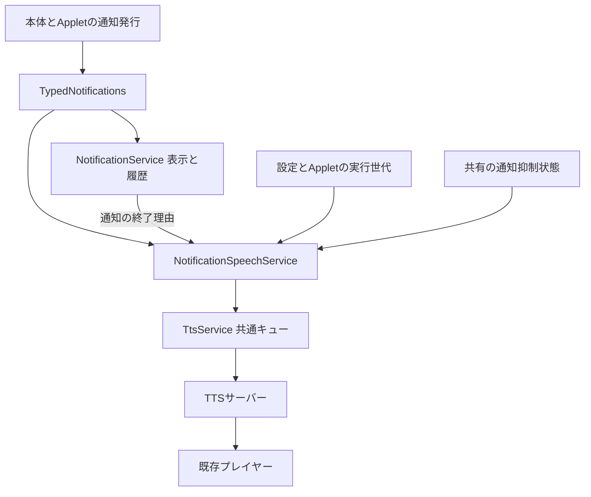

# 通知読み上げ機能の仕様と設計

状態: **実装済み**。AppDock 0.36.0の契約を示す。通知種類ごとの読み上げON/OFFと、通知全体の声・速度の上書きを定義する。接続先・モデル・APIキーは共通の読み上げ設定を使用する。

既存の契約は[通知基盤](notifications.md)、[通知種類と設定](notification-foundation.md)、[TTSサーバー連携と読み上げAPI](tts-design.md)を正本とする。設定保存とShellの描画は[設定基盤](settings-foundation.md)に従う。

## 目的と対象

通知のタイトルと本文を、設定済みTTSサーバーで音声に変換し、AppDockが動作するPCで再生する。通知表示は音声生成を待たずに処理する。

本体通知、Appletの種類指定通知、本体が提供する「旧方式の通知」を対象とする。通知発行側のAPIやmanifestへ読み上げ指定を追加せず、ユーザーが通知設定で選択する。Appletの既存の通知発行コードは原則変更しない。

初期範囲は種類別ON/OFF、通知全体の声・速度、試聴・停止、重複防止、取消、通知抑制、失敗時の継続処理とする。通知別の声・速度、接続先の上書き、読み上げ専用本文、要約、再読み上げ操作、優先割込み、音声ファイル保存は含めない。

## 設定画面

「設定 → 通知」は親許可、提供元別の通知種類、折りたたみの「通知の読み上げ」の順に配置する。種類ごとの通知先は共通選択カードで並べ、読み上げも通知先の1つとして選択する。

```text
通知種類
  通知する                          [ON]
  通知先                            バナー / デスクトップ / Windows / 読み上げ
  通知センターのみ                  [OFF]
  自動消去までの秒数
  [既定に戻す]

通知の読み上げ（詳細）
  声
    [ON] 共通の読み上げ設定を使う
    OFFの場合: 通知用の声を選択またはIDで指定

  速度
    [ON] 共通の読み上げ設定を使う
    OFFの場合: 通知用の速度を指定

  [試聴] [試聴を停止] [読み上げ設定を開く]

```

声と速度の継承は独立して切り替えられる。初期状態は両方とも継承する。継承中は現在の有効値を表示し、保存値へコピーしない。上書きを始める際は現在の有効値を初期入力とし、有効な値がない声は入力完了まで保存しない。継承に戻す操作は上書き項目を削除する。

通知種類ごとの通知先「読み上げ」は初期OFFとする。通知を無効化できない必須種類も読み上げはOFFにできる。通知自体がOFF、Appletの通知許可がOFF、Applet停止中でも読み上げの保存値を保持し、現在実行できない理由を表示する。「通知センターのみ」は視覚的な通知先が空かつ読み上げOFFの場合に選択状態となり、選ぶと`targets:[]`と`speak:false`を一度に保存する。既存設定との互換性のため、読み上げの保存先は`speak`を維持する。

「タイトルと本文を読み上げます。内容は、設定したTTSサーバーへ送信されます。」と説明する。接続先・モデル・有効な声が未設定でも種類別ONは保存できる。不足項目を表示し、共通の読み上げ設定への導線を用意する。接続確認のための自動生成はしない。

ボイス一覧は共通TTSの一覧取得を利用し、独立した接続先や一覧キャッシュを作らない。一覧更新は明示操作とし、取得失敗で保存済みボイスを消さない。一覧にないIDの直接指定も既存TTSと同じく許可する。

即時保存、入力エラー、競合検出、検索、部分JSONは既存設定基盤へ接続する。通知種類の「既定に戻す」は既存の上書きとともに読み上げONも解除するが、通知全体の声・速度は変更しない。

## 設定データと優先順位

既存の`notificationPreferences`を拡張する。保存形式は次の型に従う。

```ts
interface NotificationSpeechSettings {
  voice?: string;
  speed?: number;
}

interface NotificationPreferences {
  overrides: NotificationPreference[];
  speech?: NotificationSpeechSettings;
}

interface NotificationPreference extends NotificationOwner {
  typeId: string;
  enabled?: boolean;
  targets?: NotificationTarget[];
  durationSeconds?: number | null;
  speak?: boolean;
}
```

| 項目 | 保存・検証 | 実効値 |
| --- | --- | --- |
| `speech.voice` | 省略で継承。指定時は空白だけを拒否し、200文字以下。大文字小文字を保持 | 指定値、なければ`tts.defaultVoice` |
| `speech.speed` | 省略で継承。指定時は0.25〜4.0の有限数 | 指定値、なければ`tts.defaultSpeed` |
| 各overrideの`speak` | 任意boolean。省略時false | 通知方針が有効かつtrueの場合だけ対象 |
| 接続先・モデル・APIキー | 通知設定には追加しない | 共通TTS設定とPC専用秘密領域 |
| 速度適用方式 | 通知設定には追加しない | `tts.speedMode` |

新規項目の`null`や不明なプロパティは拒否する。既存`durationSeconds:null`の契約は維持する。設定は既存の共有`settings.json`に保存し、新しい保存ファイルを作らない。未導入・停止中の通知種類の設定を保持する。旧設定は声・速度継承、全種類読み上げOFFとして読み込む。新しい項目を保存した設定を旧版が読めることは保証しない。

通知種類編集で`notificationPreferences`を再構築するとき、`speech`を保持する。逆に声・速度の編集で`overrides`を置換しない。ページ投影・部分JSON・外部設定変更にも同じ検証を適用する。

通知用の声・速度は受付時に実効値を確定し、既存TTSの`voice`・`speed`引数へ明示指定する。通知全体の上書き変更は次の新規通知・試聴から適用し、待機・生成・再生中の値を変更しない。

共通`tts`設定やAPIキーそのものの変更には、既存TTSの取消契約を適用する。旧設定の待機・生成を取り消し、再生中は完了を許可する。通知用上書きの編集だけでは、この共通設定変更を発生させない。

## 読み上げ内容と開始条件

表示用のタイトル、本文の順に読み上げる。各部分の前後空白を除き、改行・連続空白を通常の空白へまとめ、空でない部分を句切りで結合する。ボタン名、URLの参照先、履歴用`historyText`を追加しない。両方が空白だけなら省略する。本文を要約・HTML解釈・自動分割しない。

現在の通知上限はタイトル200文字・本文2000文字であり、結合後も既存TTSの4096コードポイント上限以内となる。通知側の上限変更時にもTTS入力検証を維持し、超過は読み上げだけの失敗とする。

| 事象 | 動作 |
| --- | --- |
| 新しい通知IDの受付 | 種類別ONと実行条件を確認して1回だけ予約 |
| 同じIDの本文・レベル・操作更新 | 再読み上げしない。予約済み本文も置換しない |
| `restartTimer`による時間延長 | 再読み上げしない |
| 表示先変更、配送状態更新、既読化、Shell切替 | 再読み上げしない |
| 終了後に新IDで再発 | 新しい通知として判定 |
| 読み上げOFFからONへの変更 | 次の新規通知から適用。過去通知を走査して発声しない |
| 履歴の復元・閲覧 | 読み上げない |

視覚的な表示先が空配列でも`speak:true`なら読み上げる（画面上は「読み上げ」だけを選んだ状態）。複数表示先でも読み上げは1回とし、表示成功やOS受付を発声の条件にしない。旧通知の`silent`はWindows通知音の指定として維持し、ユーザーがONにしたTTS読み上げとは分ける。既存の通知音キューやアクセシビリティ用`aria-live`を変更しない。

## キューと取消

既存TTSの全体16件のキューへ通常ジョブとして追加し、生成から再生まで1件ずつ処理する。別の音声生成キューや優先割込みは設けない。満杯では読み上げを省略し、通知表示を維持する。

通知には発行時刻からの再生開始期限を設定する。**再生開始期限は60秒**とする。生成時間と実サーバー検証の条件・結果はVERIFICATIONへ記録する。UI設定には増やさず内部定数とする。起動準備・抑制状態の初回確認・TTS待機・生成をすべて期限に含める。再生開始前に期限を超えたジョブは取り消し、期限前に開始した再生は完了まで許可する。

| 事象 | 待機・生成・再生への対応 |
| --- | --- |
| 種類別読み上げOFF、種類の通知OFF | 該当種類の全ジョブを取消 |
| `host.notifications`がOFF | Applet通知のジョブだけ取消。本体通知は継続 |
| 手動dismiss、発行元のresolve・withdraw | 対象通知のジョブを取消 |
| 表示時間の自然な期限切れ | 取消しない。読み上げの開始期限は維持 |
| Applet停止・異常終了・実行世代変更、種類削除 | 対象の全ジョブを取消 |
| 表示先変更・既読化 | 継続 |
| 通知用の声・速度変更 | 受付時の値で継続 |
| ロック・サスペンド・通知抑制 | 自動読み上げの全ジョブを取消 |
| ホスト終了 | TTS停止と本文・音声参照の回収 |

通知の表示期限が切れても音声ジョブは残るため、取消判断をactive通知だけに依存させない。読み上げ側が発行元・種類・実行世代とTTSジョブの対応を終端まで保持し、期限切れ後の設定OFF・Applet停止でも回収する。

取消・期限切れ・失敗・キュー満杯からの自動再試行はしない。読み上げに失敗しても通知のacceptedをsuppressedへ変更せず、表示・操作・履歴を継続する。

## 起動準備と通知抑制

起動直後は通知の受付と表示を進め、読み上げだけを`startupReady`まで保留する。保留件数は最大16件とし、超過分は省略する。準備完了後も開始期限・設定・世代・抑制状態を再確認する。既存履歴から保留ジョブを作らない。

既存の`NativeNotificationState`とロック・サスペンド・本体全画面化の判定を、デスクトップ通知と自動読み上げが利用できる本体サービスへ整理する。デスクトップWindowやdesktop対象通知が存在しない場合も読み上げを抑制できるようにする。

OSが通知可能と報告し、ロック・サスペンド・本体全画面化がない場合に許可する。この判定がWindowsの全設定や実際の可聴性を完全に検出するとは扱わない。状態不明では生成・再生を始めず初回判定を待ち、問い合わせ失敗は読み上げを省略する。既存の問い合わせ失敗時の再試行方針を保つ。

通知不可と判定した間に届いた通知は省略し、解除後に再投入しない。実行中に通知不可へ変わった場合も取り消す。再生直前の検査と抑制イベントによる取消を併用する。必要な利用者がいる間だけquery workerを維持し、デスクトップ表示の終了で読み上げ側の監視まで破棄しない。

## 本体サービスの構成



`NotificationSpeechService`を`src/main/core/notification-speech.ts`へ新設する。通知本文の整形、受付済み判定、通知と音声ジョブの対応、開始期限、設定・所有者・抑制の再検証、取消を所有する。HTTP・APIキー・WAV検証・音声再生を重複実装しない。

`TypedNotifications`で通知ID・所有者・種類・実行世代が確定し、bindingを登録した後に、内容と新規／更新の区別を専用イベントで通知する。現状の`NotificationService.upsert`と`identify`はそれぞれ変更通知を発生させるため、汎用subscribeで新規発声を推定しない。読み上げ処理の例外や非同期失敗を通知発行元へ伝播させない。

新規／更新の判定は通知基盤が確定した結果を使う。設定再調整によるupsert、履歴復元、Shellのconnectを新規イベントとして扱わない。通知終了の購読も理由を識別できる契約にし、自然な期限切れと明示取消を区別する。

`requestId`は`notification:<通知ID>`のように安定して生成する。通知側も受付判定済みを保持し、TTS側の重複記録の保持期限に依存しない。同じIDで本文更新後の再送を行わない。active通知の判定済み記録は保持し、通知が終了しかつ音声ジョブが終端になった時点で回収する。終端後の履歴を発声イベントへ戻さない。

TTS受付時には本文と実効声・速度を渡す。受付後は通知側に不要な本文コピーを残さず、起動保留中の本文も受付・省略・取消時に解放する。通常の通知履歴以外へ本文、音声、読み上げ履歴を永続保存しない。

### TTS内部の拡張

公開`tts.speak`の引数・結果は変更せず、同じ`TtsService`への本体内部の接続を追加する。通知からMCPやAppletのRPCを呼び出さない。

内部専用の受付オプションで、開始期限と生成／再生直前の実行条件を受け渡す。期限timerだけではイベントループ停止や復帰時の競合があるため、生成開始前・再生開始直前にも絶対時刻を照合する。取消後のHTTP応答やプレイヤー準備完了では音声を開始しない。

ジョブ状態購読を追加し、終端を読み上げ側へ通知する。既存のUI更新callbackや監査ログを状態管理の代わりに解析しない。通知用の内部オプションは外部入力へ公開せず、既存の未知プロパティ拒否を維持する。通常のAPIジョブの10分待機期限・180秒生成期限等は既存契約を保つ。

## 所有者と許可

通知読み上げは、ユーザーが通知種類ごとに選択した本体機能とする。Applet/MCPの直接TTS利用許可`useTts`とは独立させ、通知設定の変更でそれらの許可を変更しない。

内部TTS所有者は通知IDに対応した専用の識別子とし、ホストが生成・登録する。所有者文字列だけで許可せず、対応レコード、通知方針、Appletの実行世代、起動・終了状態を検証する。種類OFFやApplet停止の取消を、既存の汎用`host`所有者へ一括適用しない。

Applet/MCPは通知用ジョブの状態取得・停止を行えない。内部所有者やジョブIDを通知発行APIの結果へ追加しない。既存の本体の全体停止は通知用ジョブも停止する。

## 試聴とエラー表示

「試聴」は保存済みの通知用声・速度と共通接続設定を使用し、固定の短いテキストを再生する。入力途中の不正値は送信しない。保存結果が未確定の間は開始できない。試聴文や音声は保存しない。

試聴は明示操作として専用のホスト所有者で扱い、通知種類のON/OFFや自動通知の抑制から独立させる。起動・終了状態、TTS入力検証、共通設定変更時の取消は適用する。連打による多重受付を防ぎ、「試聴を停止」はこの画面の試聴だけを停止する。Shell切替で再発声させない。既存の全体停止とは操作名と対象を区別する。

TTS未設定など事前に判別できる状態と試聴の失敗は設定画面に表示する。自動通知の失敗は通知ID・ジョブID・発行元・安全な理由コードをログに残す。本文・APIキー・生のサーバー応答は記録しない。通知基盤へエラー通知を再発行しない。

## 実装構成と保守

| 対象 | 変更内容 |
| --- | --- |
| `src/shared/notification-types.ts` | 設定型・検証・読み上げ方針の解決 |
| `src/shared/contracts.ts`、`src/shared/settings-schema.ts` | 設定取り込みと既定値の整合 |
| `src/shared/settings-catalog.ts`、設定ページの公開モデル・操作 | 検索、ページ投影、通知用試聴・停止 |
| `shells/default/settings/NotificationSettings.tsx` | 全体の声・速度、種類別ON/OFF、未設定理由 |
| `src/main/core/typed-notifications.ts`、`notification-service.ts` | 確定済み受付と終端理由の通知 |
| 新設`src/main/core/notification-speech.ts` | 読み上げ判断、ジョブ対応、取消 |
| `src/main/core/tts-service.ts` | 内部期限・条件検査・状態購読 |
| `src/main/core/native-notification-state.ts`、`notification-desktop-host.ts` | 表示Windowから独立した抑制状態の共有 |
| `src/main/index.ts` | 起動・設定変更・Applet寿命・終了の接続 |

1. 設定の型・検証・継承解決と、既存データの保持を実装する。
2. 通知受付・終端イベントと読み上げサービスを追加し、疑似TTSで重複・期限・取消を確認する。
3. 抑制状態とTTS内部ガードを接続し、起動・停止・復帰の競合を確認する。
4. 共通設定ページのモデル・操作とDefault Shellを更新し、試聴と即時保存を確認する。追加Shell専用の内部importや実行経路は作らない。
5. 影響範囲をレビューし、必要な回帰と隔離した配布EXEで検証する。実装時にREADMEと現行仕様を更新し、実測をVERIFICATIONへ残す。

設定項目の追加に当たるため、実装時は[共通手順](development-workflow.md)に従って本体をマイナー更新し、本体のpublishへ発行する。未変更Appletの再発行は不要。

## 検証と受入条件

| 分類 | 必須の確認 |
| --- | --- |
| 互換性 | 旧設定で全種類OFF、声・速度継承。未導入種類の設定保持 |
| 設定保存 | 声だけ／速度だけ／両方上書き、継承復帰、範囲外・空入力・未知項目拒否、競合、部分JSON、種類編集時の共通設定保持 |
| 声と速度 | 通知用設定が試聴・通知だけに適用され、共通試聴や直接APIの設定を変えない。接続先・モデル・キーは共通 |
| 受付 | 本体・種類指定・旧方式・センターのみ、複数表示先でも1回。本文更新・時間延長・既読化・Shell切替で再発声なし |
| 重複と再発 | 同じIDは1回、新IDの再発は対象。TTS重複記録の期限後でも同一activeを再発声しない |
| 寿命 | 待機・生成・再生の各段階でOFF／dismiss／resolve／withdraw／Applet停止・世代変更／ホスト終了を検証 |
| 表示期限 | 短時間で自然消去しても発声可能。自然消去後の設定OFF・Applet停止では音声を取消 |
| 開始期限 | 起動待機・キュー・長い生成を合算。遅延timer・復帰時も期限後に再生せず、開始済み音声は継続 |
| 抑制 | ロック・サスペンド・全画面・OS判定・判定失敗。desktop対象がなくても有効、解除後に再送なし |
| キューと障害 | 共通TTSとの順序、16件上限、起動保留上限、サーバー失敗、不正音声、再生失敗。通知表示・履歴は維持 |
| 権限 | 直接APIのuseTtsを変更しない。他所有者のジョブにアクセス不可、停止対象の混同なし |
| 試聴とShell | 保存済み有効値、停止対象、連打防止、入力エラー、設定検索、Shell切替と復旧 |
| 情報管理 | 新規の本文・音声永続保存なし、ログへの本文・キー・生エラー混入なし、終端時の参照回収 |
| 配布実機 | 単一EXEの隔離起動、実TTSの日本語・声・速度・生成時間・停止、実際の音声出力 |

既存の`tests/notification-policy.test.cjs`、通知サービス関連試験、`tests/tts.test.cjs`、設定とShellの関連試験を拡張し、通知読み上げ専用の試験を追加する。GUI試験は隔離profileで直列実行する。

通常試験は疑似サーバーを使い、実サーバー検証では短い専用テキストを送信する。生成成功、プレイヤー終了、実際に聞こえたことを区別する。採用した60秒の開始期限について対象サーバーで短文の生成・再生を確認し、測定条件と未確認事項をVERIFICATIONへ記録する。
