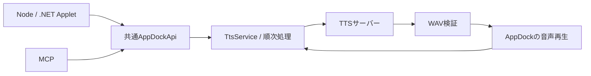

# TTSサーバー連携と読み上げAPIの設計

通知から本基盤を利用する拡張は[通知読み上げ機能の仕様と設計](notification-speech-design.md)を参照する。通知用の声・速度だけを上書きし、接続先・モデル・APIキーは共通設定を使用する。

状態: **実装済み**。AppDock 0.35.0のTTS設定・API・再生・取消の契約を示す。実測条件と結果は[検証記録](../VERIFICATION.md)へ記載する。

## 目的と初期範囲

OpenAI互換のTTSサーバーへテキストを送り、生成した音声をAppDockが動作するPCで再生する。Node/.NET AppletとMCPは同じ共通操作APIを利用する。TTSサーバーやMCPクライアント側での再生は行わない。

提供範囲:

- 接続先1件、任意のAPIキー、モデル、既定のボイス・速度の設定。
- 音声生成と順次再生、ボイス一覧、受付IDによる状態取得・停止。
- Applet/MCPの独立した利用許可、秘密情報の保護、終了時の回収。
- WAVを全量受信・検証した後に再生する非ストリーミング方式。

複数サーバー切替、ストリーミング、音声保存・共有、長文の自動分割、音声クローン作成、話し方の指示、出力デバイス選択、割込み再生は初期範囲外。出力はWindowsの既定デバイスを使用する。

## 既存基盤と構成

[共通操作API](appdock-api.md)の単一AppDockApiと操作カタログへTTS操作を追加する。AppletのJSON-lines RPCとMCPのHTTPアダプターは既存経路を使う。別のTTS用HTTPサーバーやAppletは作らない。

既存の[音声再生](../src/main/core/sounds.ts)は短い通知音向けで、WAVの16MiB制限・30秒の再生期限を持つ。audio.playの契約を保ち、TTSには生成・状態・停止を管理する専用サービスと再生経路を設ける。

[Node RPC](../src/main/core/rpc.ts)と[.NET RPC](../dotnet/AppDock.Runtime/JsonRpcConnection.cs)には標準15秒の待ち時間がある。生成・再生の終了までAPIを待たせず、受付後すぐにジョブIDを返す。音声バイナリをApplet RPCやMCPの応答へ載せない。



TtsServiceは受付・設定解決・キュー・HTTP・状態・取消を所有する。再生アダプターは検証済み音声と開始/停止・終了通知だけを扱う。mainプロセスで非同期実行し、再生rendererへ接続先・APIキー・本文を渡さない。

既存契約の正本は[外部操作](automation.md)、[設定基盤](settings-foundation.md)、[保存領域](settings-sync.md)。本書から既存契約を重複定義しない。

## 設定と保存

共有settings.jsonに任意のttsオブジェクトを追加する。未設定では接続・生成・再生を開始しない。

| キー | 内容・既定値 |
| --- | --- |
| `tts.baseUrl` | APIベースURL。未設定は空。例: `http://host:8080/v1` |
| `tts.model` | モデルID。未設定は空 |
| `tts.defaultVoice` | 省略時に使うボイスID。未設定は空 |
| `tts.defaultSpeed` | 0.25～4.0の有限数。既定1.0 |
| `tts.speedMode` | playback（既定）またはserver。速度の適用先 |
| `tts.voicesSource` | endpointまたはmanual。既定endpoint |
| `tts.voicesPath` | ベースURL配下の相対パス。既定audio/voices |
| `tts.manualVoices` | 手動ボイスのid/name配列。既定空配列 |

URL・モデル・ボイスIDに特定サーバーの値を埋め込まない。モデルは自由入力とし、モデル一覧APIは初期範囲外。ボイスIDの大文字・小文字は維持する。

APIキーは共有設定へ保存せず、safeStorageによる既存の暗号化方式に合わせてPC専用rootのホスト用秘密領域へ保存する。Applet別SecretsのIDを流用しない。暗号化不可の場合は平文へフォールバックしない。キーの登録・置換・削除はホスト設定画面に限定し、Applet/MCPへ値を返さない。必要な状態表示にはapiKeyConfiguredだけを使う。

キーはPC専用rootのtts-key.jsonへ暗号化保存し、正規化した接続先のハッシュに紐付ける。URL変更時に以前のキーを別の接続先へ自動送信しない。キー未設定ならAuthorizationヘッダーなし、設定済みの場合だけBearer認証とする。秘密情報の保存失敗は画面へ返し、成功扱いしない。

生成音声は共有data/・登録通知音に保存しない。初期実装はサイズ制限付きメモリ保持を優先し、ジョブ終了時に音声参照を解放する。ファイルが必要になった場合だけPC専用一時領域を使い、正常終了・取消・次回起動時に自分のファイルだけ回収する。本文・音声・ジョブ履歴の永続保存は行わない。

## 設定画面

既存設定へ「読み上げ」ページを追加する。通常項目はURL・APIキー・モデル・既定ボイス・速度とし、一覧方式・パス・手動一覧は詳細項目へまとめる。

即時保存・入力検証・revision競合・Shell描画は既存契約を使う。部分JSONは共有設定だけを対象とし、秘密値を含めない。保存や編集だけで音声を生成しない。「ボイス一覧を更新」「試聴」「停止」を明示操作として提供する。試聴は保存済み設定と共通TtsServiceを使い、入力本文を共有設定に保存しない。

Default Shellと追加Shellは同じ公開モデル・操作を使用する。秘密値を保存後の表示モデルへ戻さず、キー更新はホスト所有の専用操作に渡す。利用許可は「操作の許可」のApplet/MCP列へ追加する。

## サーバーとの通信

### 音声生成

サーバーのWAVはPCM/floatのRIFF形式を受け付ける。圧縮WAV・RF64等は初期対応外。

末尾スラッシュを正規化したベースURLにaudio/speechを追加してJSONをPOSTする。URL結合で/v1等のベースパスを失わない。

```json
{
  "model": "configured-model-id",
  "input": "処理が完了しました。",
  "voice": "configured-voice-id",
  "speed": 1.0,
  "response_format": "wav"
}
```

playback（既定）ではサーバーへspeed=1を送り、プレイヤーのplaybackRateへ指定速度を設定し、preservesPitchで音程を保つ。serverでは指定速度をサーバーのspeedへ渡し、AppDockは等速再生する。二重に変更せず、サーバー拒否時の自動再生成も行わない。速度はジョブ受付時に確定し、再生中の変更は行わない。

本文はUnicodeコードポイントで1～4096文字、空白だけの本文は拒否する。切詰め・自動分割はしない。モデル固有の上限がさらに厳しい場合は生成失敗とする。Node/.NET/MCPでホスト側の同じ検証を使う。

HTTP成功だけで再生へ進めない。Content-Type・RIFF/WAVEコンテナー・サイズ・デコードを確認する。JSON/HTML、破損データ、上限超過はエラー。Content-Lengthを信用して全量確保せず、受信中の累積サイズにも上限を適用する。

URLはhttp/httpsのみ。URL内の認証情報・クエリー・フラグメントを禁止し、リダイレクトは自動追従しない。本文・キー・生のサーバーエラーをログや公開エラーへ含めない。

### ボイス一覧

endpointでは同じ接続先・認証でvoicesPathへGETする。初期対応形式は次とする。

```json
{
  "voices": [
    { "id": "voice-a", "name": "Voice A" }
  ]
}
```

id必須、name省略時はIDを表示名とする。空ID・重複ID・不正な型は拒否する。別形式を暗黙に推測せず、必要なサーバーが確定した段階で明示的なアダプターを追加する。

相対パスは同じベースURL配下だけに限定する。絶対URL・先頭スラッシュ・上位参照・クエリー・フラグメントを拒否し、一覧取得だけ別の送信先へ向けない。

OpenAI互換はボイス一覧APIの互換性まで保証しない。404/405は一覧非対応として返し、認証・接続障害と区別する。自動で別パスやmanualへ切り替えない。manualでは設定一覧を返し、ネットワークへ接続しない。正常な空一覧と取得失敗を区別する。

一覧にないボイスIDもspeakで明示指定できる。一覧取得を生成の前提にしない。実際に利用可能かは生成応答で判断する。

永続キャッシュは作らない。取得期限は5秒、応答上限1MiB・1000件。共有可能な同時取得はまとめ、設定変更前の結果を変更後の一覧として表示しない。

## 共通API

次の4操作をappDockOperationsへ追加し、callersはmcp/appletとする。操作名は言語非依存、説明は日本語とする。

| 操作名 | MCPツール名 | 入力 | 結果 |
| --- | --- | --- | --- |
| `tts.speak` | `appdock_tts_speak` | text、任意voice/speed、requestId | jobId、state、completion:accepted |
| `tts.voices.list` | `appdock_tts_list_voices` | なし | voices、source:endpoint/manual |
| `tts.jobs.get` | `appdock_tts_get_job` | jobId | 状態・時刻・失敗時のエラー |
| `tts.stop` | `appdock_tts_stop` | jobId | 停止後の状態 |

voice/speed省略時は受付時の既定値を使用する。voiceも既定値も空の場合はINVALID_ARGUMENT。未知のプロパティを拒否する。URL・モデル・キーはAPI引数に含めず、設定済み接続先を使う。

requestIdは呼出し側が作る1～100文字の一意ID。同じ所有者・同じID・同じ入力の再送は保持期間内に限り既存ジョブを返す。同じIDで入力が異なる場合はTTS_REQUEST_CONFLICT。既定値や設定revisionが変わっても、同じ入力の再送は最初のジョブを返す。再送時も現在の許可を検査する。

受付と重複判定記録は一体で作成する。容量不足など受付失敗ではジョブを作らない。終了済み記録は最大512件かつ終了後30分までとし、稼働中の記録を追い出さない。期限切れ・再起動をまたぐ重複防止は保証しない。応答消失時に新しいrequestIdで自動再送しない。

jobIdは起動単位の推測困難なIDとする。状態には本文・キー・音声・生のサーバー応答を含めない。終了時に本文・ボイス・接続設定・秘密値への参照を解放し、重複判定は入力のハッシュだけを保持する。createdAt/updatedAtはUTCのISO 8601、失敗時はerror:{code,message}を返す。未知ID・記録消失・他所有者のIDはNOT_FOUND。終了済みジョブへの停止は既存状態を返し、再実行しない。

```ts
// appdock-api capabilityと読み上げの許可が必要。
const job = await context.appdock.call('tts.speak', {
  text: '処理が完了しました。',
  voice: 'voice-a',
  speed: 1.0,
  requestId: crypto.randomUUID(),
});
const current = await context.appdock.call('tts.jobs.get', { jobId: job.jobId });
await context.appdock.call('tts.stop', { jobId: job.jobId });
```

```csharp
var job = await context.AppDock.CallAsync("tts.speak", new {
    text = "処理が完了しました。",
    voice = "voice-a",
    speed = 1.4,
    requestId = Guid.NewGuid().ToString()
}, token);
var id = job.GetProperty("jobId").GetString();
var state = await context.AppDock.CallAsync("tts.jobs.get", new { jobId = id }, token);
await context.AppDock.CallAsync("tts.stop", new { jobId = id }, token);
```

.NETは既存context.AppDock.CallAsyncから同じ操作名を呼ぶ。Nodeの型付き操作一覧・入出力型と共通Schemaを更新する。起動前・終了中は既存NOT_READY契約に従う。

## 許可と所有者

読み上げ専用useTtsをApplet/MCPそれぞれに追加する。生成はread+execute+useTts、一覧はread+useTts。新規環境・既存保存形式の省略項目ともuseTtsは初期OFF。他の許可から推定して有効化しない。

状態取得はread、停止はread+executeを必要とする。useTts取消後も他の必要許可が残っていれば状態確認・停止ができる。useTts取消時にはホストが該当する稼働中ジョブを自動取消する。MCP連携OFF、Applet停止・異常終了、ホスト終了でも対象ジョブを取り消す。

所有者はホストが接続から確定し、API引数で受け取らない。Appletは自分のジョブだけを参照・停止できる。MCPは現在の認証境界に合わせた共通所有者とし、MCP起点のジョブだけを扱う。MCPクライアント同士の分離は初期実装で保証しない。ホスト画面だけは全体停止できる。

MCPからApplet公開コマンドを呼び、そのAppletがTTSを呼ぶ場合は、既存契約に従いAppletの所有者・許可を適用する。

MCPのspeakは外部通信と再生を伴う操作として宣言する。状態取得はread-only、stopは変更操作。speakには重複判定の保持期限があるため無条件な冪等性を宣言しない。監査ログは操作名・所有者・受付ID・成否に限定する。

## 状態・再生・取消

状態はqueued → generating → playing → completed。受信・検証・プレイヤー準備はgeneratingに含める。終端状態はcompleted/failed/canceledで、終端から別状態へ遷移しない。

初期実装では生成から再生までを1件ずつ順番に実行する。先行生成や並列生成は行わず、TTS同士の重なりを防ぐ。既存通知音とは別キューで、通知音との重なりは許容する。

| 制限 | 初期値 |
| --- | --- |
| 稼働中ジョブ | 全体16件。待機・生成・再生を含む |
| キュー待ち | 受付から10分。超過はfailed |
| 生成・受信 | 開始から180秒 |
| 音声受信 | 最大64MiB |
| 再生可能時間 | デコード後10分以下。超過は再生前に拒否 |
| 再生監視 | 音声長÷再生速度+30秒。終了通知がなければfailed |
| デコード後の容量 | PCM/float WAVのみ。推定256MiB以下 |

初期値は内部定数として試験し、変更には実測の根拠を残す。件数・サイズ・時間に加え、デコードによるメモリ増加も検証する。

再生のended通知でcompletedにする。HTTP成功、play呼出し成功、受付成功だけでは完了にしない。completedはプレイヤーの終了確認であり、ミュート状態や物理スピーカーから聞こえたことを保証しない。

取消は待機からの除去、HTTP Abort、プレイヤー停止、音声参照解放を行う。遅れて届く応答・イベントはジョブIDと世代で無視する。サーバー内部の生成計算まで停止できたことは保証しない。停止APIはローカル停止を確認してから返す。

設定変更時は旧設定の待機・生成ジョブを取消し、受信済み音声の再生中ジョブは完了を許可する。キー変更・削除も同様。新規受付は一貫した設定・秘密参照を確定し、処理途中で別の設定を混ぜない。許可取消・終了時は再生中も停止する。

プレイヤーはsandbox/contextIsolationを有効にし、Node・外部ページ・外部ネットワークへアクセスさせない。再生失敗・異常終了時も必ず回収し、次ジョブへ進める。通知音コードの再利用は最小限の共通部分に留め、既存audio.playの期限・登録素材の保存契約を変更しない。

## エラー契約

受付前の入力・未設定・許可・容量エラーはAPIエラー。受付後の生成・受信・再生失敗はジョブのfailed。自動再生成・再生は行わない。

| コード | 意味 |
| --- | --- |
| INVALID_ARGUMENT | 空本文、不正速度、入力上限超過 |
| TTS_NOT_CONFIGURED | 接続先またはモデル未設定 |
| API_DISABLED / NOT_READY | 既存APIの許可・起動状態による拒否 |
| TTS_QUEUE_FULL / TTS_QUEUE_TIMEOUT | 件数超過／待機期限超過 |
| TTS_REQUEST_CONFLICT | 同じrequestIdで異なる入力 |
| TTS_AUTH_FAILED / TTS_RATE_LIMITED | HTTP 401/403／429 |
| TTS_CONNECTION_FAILED / TTS_TIMEOUT | 接続障害／生成・受信期限超過 |
| TTS_SERVER_ERROR | その他HTTP失敗・サーバー拒否 |
| TTS_INVALID_AUDIO / TTS_AUDIO_TOO_LARGE | 不正音声／受信上限超過 |
| TTS_AUDIO_TOO_LONG / TTS_PLAYBACK_FAILED | 再生時間超過／デコード・再生失敗 |
| TTS_VOICES_UNSUPPORTED / TTS_INVALID_VOICES | 一覧API非対応／一覧形式不正 |

一覧取得の5秒期限もTTS_TIMEOUTとする。サーバーのエラー本文には入力テキストが含まれる可能性があるため、そのままUI・MCP・ログへ流さない。公開エラーはHTTP状態などの安全な情報に限る。

## 実装構成と保守

サービスはsrc/main/core/tts-service.ts、音声再生はtts-player.ts、秘密保存はtts-secrets.ts、共有型・設定検証はsrc/shared/tts.ts、Default Shellの設定フォームはshells/default/settings/TtsSettings.tsx。共通APIカタログ・設定・許可・本体寿命を接続する。

以下は変更時の確認順序を示す。

1. 共通Schema・型・設定既定値・秘密保存・useTts許可と移行を追加する。
2. TTSクライアント・TtsService・再生アダプターを追加し、疑似サーバーで成功・失敗・取消を確認する。
3. 共通API handlers・操作カタログ・Node型・.NET利用例・MCP公開を接続する。
4. 設定カタログとShell公開モデルへ設定ページ・一覧更新・試聴・停止を追加する。
5. 実サーバー、Node/.NET/MCP、隔離した配布EXEで検証し、現行仕様の文書を更新する。

主な対象はsrc/shared/appdock-api.ts、src/main/core/appdock-api.ts、src/main/index.ts、設定Schema/カタログ、Applet/MCPの許可保存、Shell設定モデル・描画、Nodeの共通API型と関連試験。新規サービスはsrc/main/core/配下へ置く。既存通信・SDKを一括置換しない。

利用説明はREADME、API契約は本書とappdock-api/automation/extensions、保存領域はsettings-sync、実測はVERIFICATIONへ記載する。TTS設定とPC専用キー保存の追加により、[共通手順](development-workflow.md)に従って本体を0.34.1から0.35.0へマイナー更新した。未変更Appletの再発行は不要。

## 検証と受入条件

型検査とbuild後にtests/tts.test.cjs、共通API/MCP・設定・音声の関連回帰を実行する。dotnet build tests/fixtures/dotnet/AppDock.Extensions.TtsProbe/AppDock.Extensions.TtsProbe.csproj -c ReleaseでSDKプローブを用意し、dev.bat node scripts/tts-ui-test.cjs [固定EXE]で隔離したNode/.NET/MCPと設定画面・再生を直列検証する。APPDOCK_TTS_REAL=1の明示指定時だけ、既知のTTSサーバーへ短い検証文を送って両ボイスの実再生を確認する。通常のGUI試験はローカル疑似サーバーだけを使う。

| 対象 | 確認内容 |
| --- | --- |
| 入力・設定 | 空本文、Unicode境界、速度上下限/非有限数、URL結合、キーなし、旧設定・保存競合 |
| 通信 | WAV成功、401/403/429/5xx、JSON/HTML混入、破損・上限超過、無応答、途中切断、リダイレクト拒否 |
| ボイス | 正常・空一覧、名前省略、重複・不正形式、404/405、認証失敗、manual、一覧非対応時の直接ID指定 |
| キュー | 順序・満杯・待機期限、失敗後の継続、重複受付、入力不一致、記録期限・再起動 |
| 寿命 | 各状態の停止、完了との競合、設定変更、許可取消、Applet停止、MCP無効化、ホスト終了 |
| 権限・秘密 | 独立許可、他所有者の拒否、応答・ログ・設定への秘密漏出なし、URL変更後の旧キー不使用 |
| 再生 | 日本語・対象サーバーの両ボイス・速度差、30秒超、無音/出力不可、10分上限、プレイヤー異常、通知音回帰 |
| API/画面 | Node/.NET/MCPで同じ結果、15秒超の生成、即時保存、試聴/停止、Shell切替 |
| 配布 | 単一EXEの隔離起動、外部音声ツール不要、音声回収、発行物と検証物の一致 |

疑似サーバーで契約・失敗・取消を検証してから、実サーバーでWAV実体、日本語、速度、生成時間、実際の音声出力を確認する。OpenAPIに項目があることだけで、その効果や生成成功を検証済みと扱わない。実測条件・結果・未確認事項はVERIFICATIONへ記録する。

## 外部仕様の参照

- [OpenAI Create speech](https://developers.openai.com/api/reference/resources/audio/subresources/speech/methods/create): 音声生成、速度、返却形式。互換サーバーの追加API・実装動作は別途確認する。
- [OpenAI Text to speech](https://developers.openai.com/api/docs/guides/text-to-speech): ボイス・音声形式。
- 接続するサーバーの/openapi.json、/v1/audio/voices、モデル情報を実装時に再確認する。取得したボイス・ダウンロード済みモデルのスナップショットを製品の固定仕様にしない。
